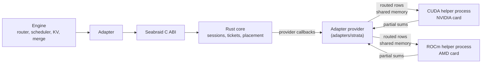
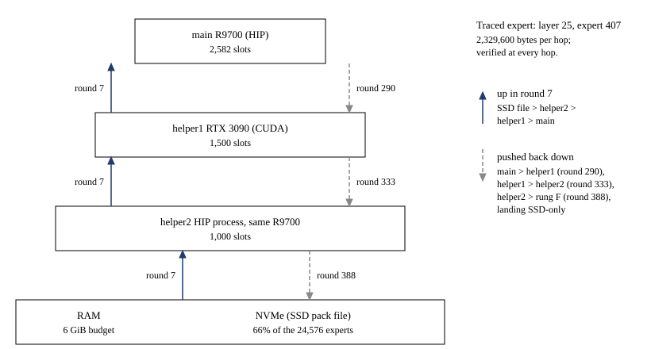
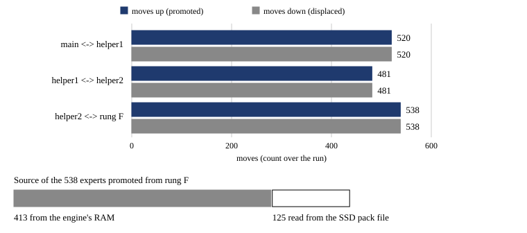
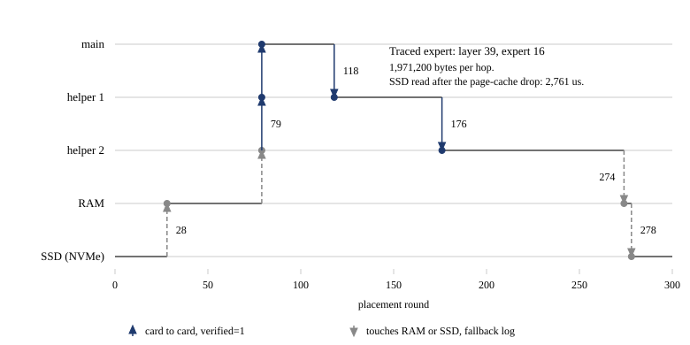

# Seabraid

**GPUs from different vendors serve one model at the same layer using their native
kernels.** With Seabraid, an NVIDIA card running CUDA and an AMD card running ROCm
each store and compute a share of the experts in the *same* Mixture-of-Experts
layer. The engine keeps its scheduler, KV cache and loader, and sends the routed
rows to Seabraid. Seabraid manages sessions, tickets and expert placement, and
calls the engine's providers (one per device) for the expert computations.

*The name refers to braiding any number of strands (vendors, kernels, devices) into one rope, representing one model.* <!-- name-etymology -->

> **Alpha: use at your own risk.** Version 0.5.0-alpha.8. The project may change at any time without notice.
> Linux x86-64 is the supported release platform. Windows source builds of the core runtime are experimental.
> The ABI can change before 1.0.
> Several paths are untested. All speed measurements come from one machine, and the older add-on figures each come from a single run.
> Created by Saltwater Research LLC. Review [what is verified](#whats-verified) before building on this release.

## Why it's new

In **expert braiding** (cross-vendor expert parallelism), GPUs from different
vendors share the experts in each MoE layer and work on that layer concurrently.
See [How it works](docs/HOW-IT-WORKS.md) for an overview.

Seabraid runs each card's vendor-native kernels in its **own process** to isolate
toolkits, allow worker replacement and contain failures. This design choice makes
no claim about runtime capabilities. Separate processes keep each vendor toolkit
out of the engine's address space. The engine can replace or retire a stalled or
dead worker without shutting down. The Rust core manages sessions, tickets and
placement, and calls a provider callback for each device. In the Strata adapter,
the provider communicates with a per-vendor helper process over shared memory
once per layer. The adapter sends the routed rows, each card computes the experts
it holds, and the helpers return partial sums. The exchange uses no network or
peer-to-peer connection.



Seabraid combines **routed experts split within one layer across vendors**,
**vendor-native workers**, an **engine-neutral C ABI**, and **acknowledged
ownership changes at a drained boundary**. Our prior-art searches (2026-11-15,
updated 2026-11-19) found no work that combines all four. A search cannot
establish priority, and we make no "first" or "only" claim.

- **llama.cpp** supports mixed vendors in one process through its Vulkan backend.
  It splits the model by layer and uses Vulkan kernels instead of native CUDA
  or ROCm kernels. Its RPC backend offloads parts of a model to remote workers
  over a network by layer or graph. HeteroLLM, a single-author benchmark, uses
  llama.cpp to split a dense 70B model by layer across an RTX 5090 and an AMD R9700.
- **Strata's `--peer-device` mode** (v0.2.15, `docs/SECOND_GPU.md`) places a
  second adaptive expert cache on another CUDA device. That device computes the
  rows for its own experts during decode windows and prompt chunks. Activations
  cross NVLink or another peer-to-peer path. The same-layer expert split runs in
  one process and supports CUDA only. Seabraid supports a same-layer split across
  vendors (CUDA and ROCm) in separate processes behind an engine-neutral C ABI.
  Strata's helper caches (`--expert-cache-device1` to `3`) and layer split
  are single-vendor.
- **Strata and Project Maya** tier experts across the VRAM, RAM and NVMe of one
  vendor's cards.
- **KTransformers and SGLang** split experts between the CPU and the GPU.
- Related systems include Tutel, FlexMoE, DeepSeek EPLB, CoX-MoE, AdaOffload,
  ThunderEP, TritonMoE, HAP, HeterMoE and MLC-LLM. We found no work that combines a
  same-layer expert split across vendors, vendor-native workers, an engine-neutral C ABI and acknowledged ownership
  changes at a drained boundary, and a search cannot establish priority. See the [technical note](docs/TECHNICAL-NOTE.md#8-related-work)
  for details and citations.

The search may have missed relevant work. Please share any additional prior art you know of.

## Why engines benefit

The design goal is to let an engine keep its router and send each additional
device the rows and picks assigned to it. Each engine needs an adapter that implements the
provider callback. Strata also needs patches applied to a pinned source tree.
The [Strata integration](compat/strata/README.md) under `compat/strata` includes patches,
a helper process and an installer that connect Strata to a device from another vendor. The integration also uses
`adapters/strata/strata-v7-seabraid.patch`.

The Strata integration has run live on one machine. The llama.cpp integration through the ggml adapter
has been verified on fixtures, and its hook does not call the runtime. The
remaining integrations below are planned and have not been implemented. The new
runtime has no demonstrated speed-up over stock.

| Engine | What it has today | What Seabraid adds | How to hook in | Status |
|---|---|---|---|---|
| **Strata** | Expert tiers across VRAM, RAM and NVMe for one vendor | A second card from another vendor as an expert tier, with live re-tiering across cards | [`adapters/strata`](adapters/strata/README.md) plus the [Strata integration](compat/strata/README.md) | The add-on was **measured**. The new runtime ran on one machine. See [results](#measured-results) and [what is verified](#whats-verified) |
| **Project Maya** | Strata-family tiering | Same as Strata | Same adapter path | Not tested |
| **llama.cpp / ik_llama.cpp** | Layer split, Vulkan support for mixed vendors and MoE expert cache | Per-layer expert split across native CUDA and ROCm providers | [`adapters/ggml`](adapters/ggml/MAP.md) and an opt-in scheduler hook patch | **Verified on fixtures** (Q4_0 on CPU, CUDA, HIP and Vulkan against ggml 1.0.0, 2026-11-17). The opt-in hook gives bit-identical results to stock llama.cpp on a loaded model across four backends. It appends ggml operations and does not call the Seabraid runtime, so no expert split inside llama.cpp has been run |
| **KTransformers, SGLang, vLLM** | CPU and GPU hybrid experts, or expert parallelism within one vendor build | A provider for a second device alongside the existing path, with mixed-vendor devices in one expert layer | Python binding or C ABI provider | Planned, not integrated |
| **Anything that routes work to a second device** | Its own routing | Sessions, partial sums and placement | A provider callback (21 lines in [`examples/minimal_provider.c`](examples/minimal_provider.c), 100 lines with its driver), [adapter guide](docs/ADAPTER-GUIDE.md) | The fixtures verify the mechanism |

## Lineage

[Strata](https://github.com/Niko1221/Strata) inspired Seabraid, particularly the
work of Niko ([Niko1221](https://github.com/Niko1221)) and the other Strata
contributors.
Expert braiding began as a Strata add-on, now in
[`compat/strata`](compat/strata/README.md). This release includes a **Strata
plug-in** with the [Strata adapter](adapters/strata/README.md), its patch and the
original add-on. Thank you to Niko and all Strata contributors. We also thank the
llama.cpp/ggml, KTransformers and SGLang developers for designs that informed
Seabraid, and the Qwen team, DeepSeek and ISTA-DASLab for the openly released
models and quantizations we used in our measurements.

Seabraid draws on Strata's architecture, particularly its adaptive tiered expert
cache (VRAM, RAM, NVMe). We wrote the Rust ownership map in
[`src/placement.rs`](src/placement.rs) by porting the map that
[patch 0012](compat/strata/patches/strata) adds to Strata. We generalized the map
using ideas from the llama.cpp ggml scheduler and its RPC backend's versioned
handshake, which [the helper protocol notes](compat/strata/docs/PROTOCOL.md)
cite as prior work. The CPU/GPU hybrid engines KTransformers and SGLang also
informed the design.

## Our tweaks, carried on our side

We maintain the Strata patches in [`compat/strata/patches/strata`](compat/strata/patches/strata/).
To apply the patches to the pinned Strata commit (v0.2.15, `c77572806`, recorded
in [`STRATA_BASE`](compat/strata/patches/strata/STRATA_BASE)), use `git am`. Opt-in patches are
off by default. Numbers 0007, 0008 and 0009 are intentionally absent. The 0007
channel v6 specification region moved to the adapter-owned
[`adapters/strata/wire`](adapters/strata/wire/) and no longer patches Strata. We
removed 0008 and 0009, the DeepSeek-V4.1 helper link and link check, because
Strata 0.2.14 removed that engine.

| Patch | What |
|---|---|
| 0002 | ExpertCache fill clamp fix |
| 0003 | DFlash2 window (**opt-in**, speculative-decode tuning) |
| 0004, 0005 | Re-tier call site and residency publishing |
| 0006 | Hot-share (**opt-in, experimental, no measured win**) |
| 0010 | Remote expert weighted output |
| 0011 | Route histograms (**opt-in**) |
| 0012 | N-card ladder ownership map and promotion (**opt-in**) |
| 0013 | D4 remote prefill (**opt-in**) |
| 0014 | Channel geometry validation and private handoff |
| 0015 | Removal of a ptrace debug switch |
| 0016 | Bounded, control-stripped reads of helper-written text; structured private-attach result |
| 0017 | One channel per helper process; a blob swap the helper writes and reads back |
| 0018 | Names where an expert's bytes live and sends a file reference (wire v9) |
| 0019 | A lost helper closes its card instead of ending the engine (the exit watch, the layer deadline, the rows computed on the CPU) |
| 0020 | A helper that is already dead at engine start opens as a closed card whatever state its last engine left (after a graceful stop too); a live helper still in `kShutdown` is waited for |

Patch 0001 adds the external expert helper tier. The llama.cpp patch,
[`adapters/ggml/llama-cpp-qwen3moe.patch`](adapters/ggml/llama-cpp-qwen3moe.patch),
is opt-in.

## Requirements

The native wheel targets Linux x86-64 with glibc 2.34 or newer (`manylinux_2_34_x86_64`).
It was tested on one Linux machine. The build requirements are listed below.

- Python 3.11 or newer (`requires-python` in `pyproject.toml`) and `setuptools>=77`
  to build the package (a `pyproject.toml` build requirement). A venv created with
  Python 3.12 or newer does not include setuptools. Install it with
  `pip install "setuptools>=77"` in the active venv before building the wheel below.
- Rust 1.79 or newer with `cargo` (`rust-version` in `Cargo.toml`). If your shell cannot find
  `cargo` after a standard `rustup` install, add it to the current shell with
  `export PATH="$HOME/.cargo/bin:$PATH"`.
- CMake 3.22 or newer (`cmake_minimum_required` in `CMakeLists.txt`) and a C11
  compiler for the native tests, the SDK and the C example.
- `readelf` (binutils), required only for `scripts/build_wheel.py` on Linux.

## Quickstart

Use the [user guide](docs/USER-GUIDE.md) to choose a setup path. If you're
developing an engine, start with [engine integration](docs/ENGINE-INTEGRATION.md).

Install the published package on Linux x86-64 (glibc 2.34 or newer). Stock Ubuntu
blocks `pip install` outside a virtual environment (PEP 668), so use a venv:

```sh
python3 -m venv .venv && . .venv/bin/activate
pip install seabraid
```

For Rust, run `cargo add seabraid`. PyPI has a Linux x86-64 wheel only, so on
Windows and macOS build from source as shown below.

You can run the Python example without a GPU. From a checkout of this repository:

```sh
python3 -m venv .venv && . .venv/bin/activate
pip install .
python examples/quickstart.py     # runs on the pure-Python reference provider
```

`pip install .` needs network access to build in an isolated environment and
download `setuptools>=77`. For an offline install, create the venv with
`python3 -m venv --system-site-packages .venv` if the system already has
`setuptools>=77`, then install with `pip install --no-build-isolation .`.

The pure-Python example produces the following output without a warning.

```text
seabraid 0.5.0a8
provider=reference result=[2.5, 5.0]
stale epoch refused: status 2
card order: RX 7900 XTX > RTX 3060 (basis: Basis(card1='lead', rest='rows'))
```

`seabraid.Runtime(reference=True)` explicitly selects the built-in demonstration
transform. Without a native library, the Python reference provider runs it
without a warning because the choice is explicit. A bare `Runtime()` without a
library would warn. Set `library_path` or `SEABRAID_LIBRARY` to a built library
to run the same transform in the native engine. The native library never
selects a transform automatically. See the [Python binding map](bindings/python/MAP.md).
To run the example natively, build the library and specify its absolute path.

```sh
cargo build --offline
SEABRAID_LIBRARY="$PWD/target/debug/libseabraid.so" python examples/quickstart.py
```

```text
seabraid: WARN: seabraid_session_submit: placement_epoch 1 is stale: the session already accepted 2
seabraid 0.5.0a8
provider=native result=[2.5, 5.0]
stale epoch refused: status 2
card order: RX 7900 XTX > RTX 3060 (basis: Basis(card1='lead', rest='rows'))
```

The `seabraid: WARN` line is **intentional**. The example submits an old placement
epoch to show that the native library rejects it and logs the refusal. The
warning goes to stderr, so it can appear anywhere in the output.

A **platform wheel** includes the native library. Installing it requires no
source build. To run `python scripts/build_wheel.py`, you need `cargo`, setuptools
(install with `pip install "setuptools>=77"` in the venv) and, on Linux, `readelf`.
The script builds the release library offline and writes the wheel to `dist/`. The Linux
x86_64 wheel uses the tag `manylinux_2_<y>_x86_64`, where `y` is the newest glibc
symbol version the library needs. The script rejects any other shared-library
dependency. Install the wheel in a **fresh** venv. If you already ran
`pip install .` in that venv, pip reports "already installed" and leaves the pure
package in place. `--force-reinstall` also works.

With the build venv from the quickstart active, run these commands from the
repository root. For an offline build, the venv must already have `setuptools>=77`.

```sh
pip install "setuptools>=77"
python scripts/build_wheel.py
python3 -m venv .venv-wheel
.venv-wheel/bin/pip install --no-index dist/seabraid-*.whl
SEABRAID_LIBRARY="$(.venv-wheel/bin/python -c 'import seabraid;print(seabraid.bundled_library())')" \
    .venv-wheel/bin/python examples/quickstart.py
```

To opt in to native mode in code, specify a provider. Native mode requires one
and never selects it automatically.

```python
runtime = seabraid.Runtime(seabraid.bundled_library(), reference=True)
```

`bundled_library()` returns `None` on the pure package. The wheel was built and
installed on one Linux x86_64 machine.

### Experimental Windows core runtime

To try the core DLL, use a Visual Studio developer
terminal with the C++ build tools, Windows SDK and Rust MSVC toolchain. From the repository
root, run `cargo build --release --locked`. The expected output is `target/release/seabraid.dll`.
Native Windows inference still needs verification. The Strata installer and helper-process transport
target Linux. The Windows core build does not provide a Windows Strata helper. macOS is unverified.

To build and install the Rust and C components, run these commands.

```sh
cmake -S . -B build/seabraid -DSEABRAID_BUILD_NATIVE_TESTS=ON
cmake --build build/seabraid
ctest --test-dir build/seabraid --output-on-failure

cmake --install build/seabraid --prefix /path/to/seabraid-sdk
```

Install the SDK outside the source tree. Setting `--prefix` inside the checkout
or an unpacked archive puts the SDK where the repository checks and `pytest tests`
scan.

CMake runs `cargo build --release` offline and always uses the release profile.
The standalone `cargo build --offline && cargo test --offline` is only needed
for the Rust and Python path, such as running `cargo test` or building the library
for `SEABRAID_LIBRARY`. With a multi-config generator (Visual Studio, Xcode, Ninja
Multi-Config), add `--config Release` to the build, test and install commands.
The single-config generators (Makefiles, Ninja) ignore it, so the commands above omit it.

The SDK directory is relocatable. Add the following to your project.

```cmake
find_package(Seabraid CONFIG REQUIRED)       # set CMAKE_PREFIX_PATH to the SDK
target_link_libraries(my_app PRIVATE Seabraid::runtime)
```

[`examples/consumer/CMakeLists.txt`](examples/consumer/CMakeLists.txt) is a complete
project that builds `examples/minimal_provider.c` this way. An installed copy
requires `INSTALL_RPATH` set to `$ORIGIN/../lib`, as shown in that file and the
[user guide](docs/USER-GUIDE.md#32-use-it-from-your-project). Without CMake, use
`gcc` with the installed SDK. Replace `<sdk>` with the `--prefix` you used for installation.

```sh
mkdir -p build
gcc -std=c11 -I<sdk>/include examples/minimal_provider.c -L<sdk>/lib -Wl,-rpath,<sdk>/lib -lseabraid -o build/minimal_provider
./build/minimal_provider
```

Put the binary under `build/`, which Git and the release checkers ignore. Keep
it out of the repository root.

Use `-Wl,-rpath` because the library's SONAME is `libseabraid.so.0.5`.

[`examples/minimal_provider.c`](examples/minimal_provider.c) provides a complete
provider implementation. At startup, a C or C++ consumer should compare
`seabraid_abi_epoch()` with `SEABRAID_ABI_EPOCH`. On Linux, the library is
`libseabraid.so.0.5`, with `libseabraid.so` as the development symlink. A null
provider is invalid. To explicitly select the built-in demonstration transform,
pass `SEABRAID_PROVIDER_REFERENCE` to `seabraid_session_open`. For more details,
see the [adapter guide](docs/ADAPTER-GUIDE.md) and the
[ABI reference](docs/ABI.md).

The load simulator (`tools/sim`) is POSIX only and off by default. Add
`-DSEABRAID_BUILD_TOOLS=ON` to build it in the same build directory.

```sh
cmake -S . -B build/seabraid -DSEABRAID_BUILD_TOOLS=ON
cmake --build build/seabraid --target seabraid_sim
build/seabraid/tools/sim/seabraid_sim                 # one run with the defaults, one JSON line
bash tools/sim/matrix.sh --quick                     # a sweep, one JSON line per run
```

`seabraid_sim --help` lists every simulator flag and its default. `matrix.sh`
lists its own flags at the top of the script. `matrix.sh` looks in `build/seabraid`
by default. Specify another build directory or the binary with `--bin` or
`SEABRAID_SIM`.

## What's verified

Alpha.7 validation exercised primary-only, static mixed-GPU, ladder and
file-move configurations on IQ3_S. A mixed-GPU conversation reused a cached
prefix and recalled its opening code at 32,313 prompt tokens. The separate
installer check created and verified a fresh native expert manifest using
prebuilt binaries and redirected service installation. See [validation notes](docs/STATUS.md)
for the tested scope and remaining coverage.

The [research log](docs/RESEARCH-LOG.md) records the date, hardware class,
workload and result for each row below. Raw output and per-run timings are
stored outside this repository, so the tree alone cannot reproduce the results
from these dated records. To get current test counts, run the commands in
[Quickstart](#quickstart). This section omits exact test counts because they go
out of date. A figure appears only if the log identifies where it was recorded.

| Claim | Status |
|---|---|
| Rust tests and CTest coverage in Release and ASan+UBSan builds: smoke tests for providers, placement and diagnostics, the minimal provider example, SONAME linking, library loading from another directory, Rust core, linked Python, and Strata fixtures including helper and controller death | **Passed on Linux** at each recorded commit, 2026-11-16 to 2026-11-18 ([log](docs/RESEARCH-LOG.md#2026-11-17--verification-on-strata-v0215)) |
| Using the installed SDK with `find_package(Seabraid)` from outside the tree, and building the native tests with ASan/UBSan | **Verified on Linux, 2026-11-16** ([log](docs/RESEARCH-LOG.md#2026-11-16--linux-gates)) |
| ggml routed SwiGLU on a Q4_0 fixture | The direct callback was verified on CPU, CUDA (RTX 3090), HIP (R9700) and Vulkan (both cards) against ggml 1.0.0, 2026-11-17. The scheduler hook was verified on a CPU fixture ([log](docs/RESEARCH-LOG.md#2026-11-14--architecture-changes-relative-to-strata)) |
| Compatibility series 0001-0006 and 0010-0020 plus the opt-in v7 patch on **Strata v0.2.15 (`c77572806`)** | **Verified on Linux, 2026-11-17, for patches 0001-0006 plus 0010-0016**. Patches 0017 and 0018 came later and have **not** been through this Strata build and ctest run. The repository's patch files apply with plain `git am`, and the HIP (gfx1201) and CUDA (sm_86) trees build. Strata's ctest results on the patched tree were CPU 138 pass / 0 fail, HIP 291 / 2, CUDA 357 / 2. The failures were `ple_parity` (model not installed) and two failures that also reproduce on a pristine v0.2.15 tree: `conversation_copy_streams_test` on ROCm 7.13 / gfx1201 and `cuda_spill_guard` with nvcc 12.4. See the upstream findings in [STRATA-INTEGRATION 4.6](compat/strata/docs/STRATA-INTEGRATION.md) |
| Expert split with an external helper on real hardware (older Strata integration) | **Measured** on one machine, n=1. See [results](#measured-results) |
| Live cross-vendor runs of the new runtime with Strata on an R9700 (HIP) and the Seabraid helper tier on an RTX 3090 (CUDA) | **Run on one machine.** On 2026-11-16, greedy decode ran at 89.5 to 95.0 tok/s (6 runs). Killing the helper caused the request to fail in 0.33 to 0.44 s, and serving continued. Runs on 2026-11-17 used Strata v0.2.15 (`c77572806`) with the repository's patch files, 6 runs per arm, IQ3_S and 2,000-token greedy decode. R9700 HIP main + RTX 3090 CUDA helper averaged 94.8 tok/s (sd 3.0). With the roles reversed, RTX 3090 CUDA main + R9700 HIP helper averaged 106.7 tok/s (sd 2.0). A SIGKILLed helper caused the request to fail in 0.33 to 0.46 s (first arm) and 0.51 to 0.73 s (second arm). The engine served the next request and no zombie processes remained (three kills per arm) ([details](adapters/strata/README.md#opt-in-strata-source-integration)) |
| Cross-vendor output quality on v0.2.15, 2026-11-17, using a KL gate against the same main card alone (three short texts, one engine start per arm, thresholds in [`arms.json`](compat/strata/scripts/placement-qual/arms.json)) | **Pooled results passed in both card orders.** The KL values are recorded outside the repository and are not reproduced here. One start per arm and three short texts make per-text results noisy ([log](docs/RESEARCH-LOG.md#2026-11-17--verification-on-strata-v0215)) |
| Long prompts on the private helper tier, 2026-11-17 | The test found the needle at every prompt length through 261k. With the RAM-copy fix and the R9700 as the main card, the first token arrived at 32k in 20.3 and 18.0 s (before: 32.0-35.7 s), at 128k in 80.7 s (before: 135.5 s) and at 261k in about 128 s (before: 260-269 s). Short-chat decode stayed unchanged (91.8-98.4 tok/s) ([log](docs/RESEARCH-LOG.md#2026-11-17--long-prompts-on-the-private-helper-tier)) |
| D4 remote prompt compute (patch 0013, opt-in) on v0.2.15 | The path engaged and processed an 8.3k-token prompt **more slowly than lending** in this test (n=2, one machine). It is off by default ([log](docs/RESEARCH-LOG.md#2026-11-17--verification-on-strata-v0215)) |
| llama.cpp loaded-model parity, CPU | **Verified on Linux, 2026-11-17.** With Qwen3-30B-A3B on llama.cpp v1.0.0, the results were bit-identical to stock with the hook off and on across 2,044 positions (4 texts). On one backend, the hook appends the same operations as stock, so equality is expected. A call counter showed hook engagement only on a 12-layer cut. Engagement on the full model was not shown. One line in the source archive's hook differed from the expected patched graph, so the graph variant compiled into each historical binary is not established (audit detail in the [log](docs/RESEARCH-LOG.md#2026-11-1718--llamacpp-hook-logits-parity)) |
| llama.cpp loaded-model parity, CUDA, HIP and a Vulkan two-vendor layer split | **Verified on Linux, 2026-11-18** with the same model. With the hook on, the results were bit-identical to stock runs on the same backends: RTX 3090 (CUDA), R9700 (HIP) and an RTX 3090 + R9700 Vulkan **layer split**. The hook only appends ggml operations and does not call the Seabraid runtime. Vulkan uses llama.cpp's own layer split. The runs show that the hook leaves results unchanged on these backends. They do not show a Seabraid expert split or establish transfer cost or speed. The tree contains no decode-time comparison |
| The placement pyramid on real cards, live run L1, 2026-11-19. Capped capacity with R9700 (HIP) main, RTX 3090 (CUDA) helper 1, a second HIP helper process on the same R9700 as helper 2, and engine RAM + NVMe at rung F | **Run on one machine.** All 1,539 moves in 513 rounds across the three boundaries committed and passed verification. Decode-path KL was 0.00132 and 0.00130 against the main card alone (gate 0.03). **Failed on helper loss.** Killing a named helper stalled decode for 30 s, then the engine exited. The fixes in patches 0019 and 0020 were re-run on GPUs on 2026-11-20 and passed (see the helper-loss row below). **Not exercised in L1:** file-reference moves (see L2 below), compaction or a third physical card. SSD starvation and system load affected the 4.2 to 7.8 tok/s decode rate. The run does not support a performance claim ([log](docs/RESEARCH-LOG.md#2026-11-19--live-run-l1-the-pyramid-on-real-cards)) |
| One expert through every level and file-reference moves, live run L2, 2026-11-20. The run used the L1 layout, built from commit f423da7 with Strata patches 0001 to 0018 and the v7 patch | **Run on one machine.** The cell at layer 39 / expert 16 completed all eight transitions (SSD to RAM, RAM to helper 2, helper 2 to helper 1 to main, back down, and RAM to SSD only) in 428 rounds. In total, 7 of 14 steered cells did so. There were 1,281 committed moves, 3 non-committed and 0 stale epochs. The file-reference test recorded 744 moves in 248 rounds with no uncommitted moves. There were 124 hops by file reference, and helper file I/O recorded 256,307,200 direct bytes with `bad_sum=0`. With file moves active, decode-path KL was 0.00116 and 0.00121 against a noise floor of 0.00116 (gate 0.03, top-1 0.95). `verified=1` covers card-to-card hops. The two hops touching the fallback log `verified=0` by design. A page-cache drop and a 2.76 ms read support an inferred drive read. No block-level trace was used. The per-step RAM and SSD lines came from a test build with extra logging; the shipped build logs the card moves. **Not run:** compaction with the pyramid. Its flag acts only on the private helper tier, which has one helper. The decode rate of 1.9 to 4.8 tok/s was affected by system load of 8 to 23. The run does not support a performance claim ([log](docs/RESEARCH-LOG.md#2026-11-20--live-run-l2-one-expert-through-every-level)) |
| Losing a named helper, live runs HL and HL2, 2026-11-20. The L1 layout; HL on patches 0001 to 0019 and the v7 patch (commit f04173e), HL2 with patch 0020 | **Run on one machine.** A helper killed mid-request: 7 of 7 requests OK in each run, one engine start, and the dead helper's card closed 22 to 93 ms after the kill while the request in flight finished. A helper killed while idle: 4 of 4 later requests OK; the card closes at the next layer request, 34 to 203 ms into it. Restart with both helpers dead: ready in 32 to 35 s with one warning per card after a SIGKILL of the engine; after a graceful stop it failed in HL (the engine exited, state 5) and passed in HL2. Not shown on GPUs: a restart while a live helper is still in its shutdown state (CPU test only). Load on the machine was not clean, so no timing is a performance figure ([log](docs/RESEARCH-LOG.md#2026-11-20--helper-loss-on-gpus-hl-hl2)) |
| Windows handle handoff | **Not yet run** |
| Live promotion timing on a real model. Matched arms compared the Seabraid placement publisher with static placement and the legacy publisher on Strata v0.2.15, R9700 HIP main + RTX 3090 CUDA helper, 2026-11-18 | **Run on one machine, small n (2-4 starts per cell).** This initial run did not pass. **Mean decode did not pass** and includes stalls, defined as pauses of 10 s or more in a request. The stall counts by arm were private live 3 of 12, private static 0 of 12, zero-move control 0 of 12, named channel new publisher 2 of 12, named legacy 1 of 12, and named static 1 of 12. Across requests, there were stalls in 15 of 194 promotion requests and 5 of 140 static or control requests. Every kind of arm also produced short warnings. Recomputing the archived request means gives 93.66 tok/s for private static and 75.66 tok/s for private live (independent audit, 2026-11-19). Whether moves or host memory pressure caused the stalls is **not established**. Pinned expert RAM leaves about 285 MiB free. Resolving the cause requires varying RAM headroom and promotion separately. Placement does not settle at the default margin and interval. For one KL text, the result after moves is about 4x its noise floor. The fence budget (100 ms) is provisional. Live promotion remains **experimental and opt-in**, and static placement is the supported baseline. Exact figures were recorded outside the repository ([log](docs/RESEARCH-LOG.md#2026-11-18--first-matched-arm-run-of-the-live-placement-publisher-s8)) |
| vLLM, SGLang, KTransformers, Project Maya adapters | Not implemented or tested |

### The pyramid on real cards (live run L1)



*Figure 1. Live run L1 on one machine (the main card an R9700 on HIP, helper1 an RTX 3090 on CUDA, helper2 a second HIP process on the same R9700, not a third card, rung F the engine's RAM plus NVMe): expert 407 of layer 25 climbs from the SSD file to the main card in round 7 (solid arrows) and is pushed back down in rounds 290, 333 and 388 (dashed arrows).*



*Figure 2. Committed placement moves per boundary and direction in the natural-traffic run (1,539 moves in 513 rounds, all verified), and where the 538 promotions from rung F came from.*



*Figure 3. Live run L2, same machine: one expert (layer 39, expert 16, 1,971,200 bytes) goes SSD to RAM in round 28, to helper 2, helper 1 and main in round 79, back to helper 1 (118), helper 2 (176), RAM (274) and the SSD (278). Solid arrows are card-to-card hops (`verified=1`); dashed arrows touch RAM or the SSD and `verified=0` by design (the fallback copy has no read-back). The SSD read after the page-cache drop took 2,761 us; that the bytes came off the drive is inferred, not traced at block level.*

The run used one machine with capped capacity (66% of 24,576 experts on NVMe).
Under natural traffic, all 1,539 moves in 513 rounds committed with `verified=1`.
The engine's RAM supplied 413 of the 538 promotions from rung F, and the SSD
pack file supplied 125. Survival after losing a named helper failed in L1 and was
re-run on GPUs after the fixes in patches 0019 and 0020 (see the helper-loss row of the
table above). This run's decode speed is not a performance claim. The
[technical note](docs/TECHNICAL-NOTE.md#live-pyramid-l1) contains all four figures.

## Measured results

These measurements use the [Strata integration](compat/strata/README.md) (Strata
plus a second-vendor helper). They do not use the new runtime. Each figure
comes from a single run (n=1) unless a run count is given. The model is
Qwen3.8-Flash-Next (GSQ-RCO quants) unless stated otherwise.

| What | Hardware | Result |
|---|---|---|
| Model fits on the main card | R9700 32 GB main + RTX 3060 helper | A tie at 95.9 vs 96.0 tok/s e2e (stock) |
| Model does not fit (expert cap 4,000) | same | The add-on answered 8 of 10 classification prompts at ~70 tok/s decode. Stock answered 0 of 10 (hung). Stock greedy decode ran at 52-60 tok/s |
| IQ3_S, all in VRAM | R9700 main + RTX 3090 helper | 105.5 / 106.0 / 105.6 tok/s (tiered) and 105.9 / 105.9 / 105.6 (all-VRAM), 3 x 2,000-token greedy |
| DeepSeek-V4.1-Flash, 128 tokens (historical measurement from 2026-11-07 on Strata 0.1.58, add-on build `c9823b0`, tree `21f4e766`. Strata 0.2.14 removed its DeepSeek-V4.1 engine, so the add-on no longer builds it) | R9700 main + RTX 3090 helper | 10.08 tok/s vs 6.17 stock in the same session |
| Teacher-forced KL, 441 positions | R9700 + RTX 3060 | 0.0025 for stock vs stock and 0.0098 for Strata integration vs stock (top-1 96.1%) |

The evidence is limited.

- When the model fit on the main card (expert cap 11,000), the add-on tied
  stock at 95.9 vs 96.0 tok/s end to end. At a cap of 4,000, the model did not
  fit. The add-on answered 8 of 10 classification prompts, and stock answered
  0 of 10. This was a different metric and workload. Stock's greedy decode
  speed came from a separate measurement. Two points do not show that a
  benefit exists only above a size threshold. No paired, repeated sweep was run.
- The 3090 gain over the 3060 setup came from swapping the card. Tiering did not
  account for that gain.
- An independent review attributed the historical DeepSeek speed-up
  (2026-11-07, Strata 0.1.58) to I/O relief. The 3090 acts as a cache in front
  of slower storage. More host RAM would likely have the same effect.
- **The DeepSeek KL gate (2026-11-07, Strata 0.1.58) failed** its thresholds.
  Noise dominated the result. Perplexity was +3.0% and +3.6% above stock. The
  issue remains open and unexplained. Do not rely on the DeepSeek path for
  output quality.
- Hot-share remains off and has no measured benefit.

See the [add-on README](compat/strata/README.md) and the
[technical note](docs/TECHNICAL-NOTE.md#6-measured-results) for the full table,
sources and further caveats.

## Documentation

[Status: what works today](docs/STATUS.md) · [How it works](docs/HOW-IT-WORKS.md) · [User guide](docs/USER-GUIDE.md) · [Engine integration](docs/ENGINE-INTEGRATION.md) ·
[ABI reference](docs/ABI.md) · [Adapter guide](docs/ADAPTER-GUIDE.md) ·
[Architecture](docs/ARCHITECTURE.md) · [Options catalog](docs/OPTIONS.md) · [Placement](docs/PLACEMENT-ABI.md) ·
[Input capabilities](docs/INPUT-CAPABILITIES.md) · [Decisions](docs/DECISIONS.md) ·
[Roadmap](docs/ROADMAP.md) · [Research log](docs/RESEARCH-LOG.md) ·
[Technical note](docs/TECHNICAL-NOTE.md) · [Module map](MAP.md) ·
[Changelog](CHANGELOG.md) · [Contributing](CONTRIBUTING.md) (contributions are currently closed)

## Privacy

The runtime makes **no network connections** and **collects nothing**. It sends
no telemetry, checks for no updates and uploads no crash reports. Batches move
only within one process or through shared memory on one machine. This is a
contribution rule ([CONTRIBUTING](CONTRIBUTING.md)). The repository checkers in
[`checks/`](checks/) enforce it and keep machine names, paths and addresses out of
the tree.

## Security

Report vulnerabilities privately using the instructions in [SECURITY.md](SECURITY.md).

## License

Seabraid's runtime and Python package are licensed under [Apache-2.0](LICENSE).
The public C headers `include/seabraid/*.h` are available under Apache-2.0 or [MIT](LICENSE-MIT).
The Strata and llama.cpp/ggml integration patches carry MIT terms. [NOTICE](NOTICE)
records the scope and upstream attribution.

Created by Saltwater Research LLC.

## Citation

See [CITATION.cff](CITATION.cff) and the [technical note](docs/TECHNICAL-NOTE.md).
