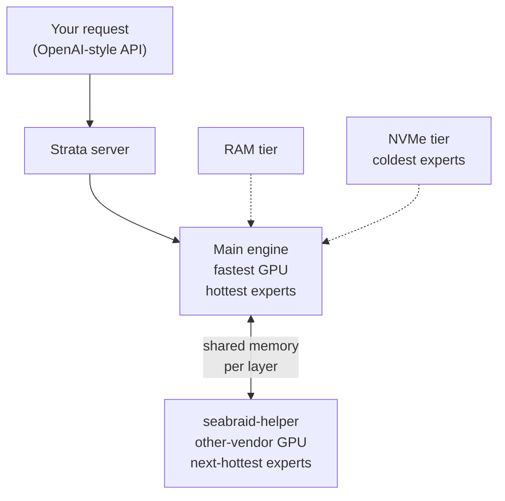

# seabraid: an expert-helper add-on for Strata

**Strata integration lets a second GPU, even one from another vendor, serve Mixture-of-Experts (MoE) experts for a model that one
card cannot hold. It is an add-on for the [Strata](https://github.com/Niko1221/Strata) inference engine.** It is the
original implementation of the idea that the engine-neutral Seabraid runtime (the repository root) generalises, and it stays
here as a compatibility distribution: the patches, the helper process and the installer below are what produced every
measurement on this page.

This integration builds the main Strata engine for the selected main GPU's toolkit. Each additional card runs a small
**helper process** built for its own backend. For each layer, the engine sends routed rows through shared memory.
The helper computes the experts it holds and returns partial sums through the same channel.



Status: a research project. The speed numbers below are real measurements from one test system; the caveats next to
them matter. Strata integration only pays off when the model overflows the biggest card.
This compatibility distribution is included in the private `0.5.0-alpha.8` pre-release.

Everything here is relative to this directory (`compat/strata`). Run the commands below from it.

**Strata pin: v0.2.15, the full commit SHA in [`patches/strata/STRATA_BASE`](patches/strata/STRATA_BASE)** (its one owner; prose never copies it,
`tests/install/test_strata_pin.py` fails on a copy). The series is 0001-0006 and 0010-0020; 0007 (the channel's v6 spec region) was
only the wire header, which `adapters/strata/wire` now owns. Patches 0008 and 0009 (the DeepSeek-V4.1 helper link) were dropped because Strata
0.2.14 removed its DeepSeek-V4.1 engine; the numbers are not reused. We do not maintain Strata: the series follows its latest
release with minimal change, and which models run is the engine's business. The installer uses Strata's own build flags,
plus `-DSTRATA_MMQ=ON` (see "Manual build"). Two tests fail on pristine v0.2.15 as well, so they are upstream findings, not ours: see
[`docs/STRATA-INTEGRATION.md`](docs/STRATA-INTEGRATION.md) section 4.6.
## Privacy and security

- Nothing in this add-on collects or sends your data. The installer and tools talk only to the server on your own machine.
- Every request to the local server bypasses `http_proxy` / `HTTPS_PROXY` settings, so a prompt never leaves the host
  through a proxy.
- Logs name tools and files by basename only. They never contain full paths, environment values, host names, user
  names, GPU UUIDs, prompts or tensors. Errors are logged, not swallowed: pass `-v` to the installer for the diagnostic
  trail on stderr; the helpers log every error they also report over shared memory.
- The server binds to `127.0.0.1` by default. The installer refuses any other `--host` unless you also pass
  `--api-key-file PATH` (a file you own, mode 600, one key of 16+ characters). The key is read by the service at
  start-up and is never written into a unit file or a command line.
- Patch `0015` removes a debugger switch (`SEABRAID_STRATA_PTRACER`) that earlier patches added, which let any process of the
  same user attach to the engine. Patch `0016` bounds and strips every helper-written string the engine reads. Both were
  carried unchanged in content onto Strata v0.2.15 (only line offsets and context moved; the `src/dsv41` hunk of 0016 is gone with that engine).

## How it works

- **Expert split, not layer split.** Every layer runs on both cards. A token uses a handful of the layer's experts, so
  experts are placed by how often they fire and each card computes the ones it holds.
- **Tiers.** Experts fill the main card, then the helper card, then RAM, then NVMe, hottest first. Strata's adaptive
  swaps keep the hot set current; Strata integration's optional re-tiering (`--retier`) moves experts between cards at run time.
- **Opt-in extras (all off by default; the evidence and what was left out are in the design log).**
  `--retier-promote on` (with `--retier on`) promotes the helper card's hot experts to the main card at run time;
  `seabraid-helper --prefill-tokens N` plus the engine variable `STRATA_PREFILL_REMOTE_COMPUTE=1` lets the helper card compute its own
  experts while a prompt is read instead of lending them (prompt reading, not decode); `STRATA_ROUTE_HIST=<dir>` writes per-request
  routing histograms for `tools/route_hist_report.py`.
- **Native toolkits only.** ROCm/HIP kernels on AMD, CUDA kernels on NVIDIA. No Vulkan.
- **Failure contract.** A mismatch at open fails fast (engine, geometry, ABI). An error after open fails open and
  loudly: a lost or failing helper closes its own card and the engine keeps serving (see "Known requirements and
  limits").

## Requirements

- Linux (Windows is out of scope). Python 3 for the installer (standard library only), `git`, `cmake`, a C++17 compiler.
- A GPU toolkit for each vendor you use: ROCm with `hipcc` for AMD, CUDA with `nvcc` for NVIDIA.
- Strata's model data directory with at least one installed pack (Strata's own `setup.py` creates it).
- Enough host RAM for the model's non-resident tiers. If experts live in RAM on AMD, read the limits below first.
- The installer ranks cards with the Seabraid Python binding in `../../bindings/python` (`seabraid.ranking`). Run it from a full
  Seabraid checkout; `install/__init__.py` puts that directory on `sys.path` for you.

## Install

One command detects the machine, proposes a plan, and asks before changing anything:

```bash
python3 install/seabraid_setup.py                      # interactive
python3 install/seabraid_setup.py --plan-only          # detect + plan, change nothing
python3 install/seabraid_setup.py --pack NAME --yes    # accept the recommended answers
```

`--plan-only` prints the machine report, blockers with their fixes, and the proposed plan. A device-specific blocker
(for example an AMD GPU with no ROCm toolkit) excludes that card; a usable primary can still produce a ready plan.
Global blockers and an infeasible plan produce a non-zero exit. Use `--detect-only --strict` to exit non-zero for any
detection blocker, including an excluded secondary card.

Useful flags: `--detect-only`, `--dry-run`, `--no-build`, `--no-start`, `--data-dir DIR`, `--work-dir DIR`,
`--port N`, `--host ADDR`, `--api-key-file PATH`, `--max-context N`, `--jobs N`, `--rocm-path DIR`, `--cuda-path DIR`,
`--ladder`, `--file-moves`, `-v`, and `--bench` (measure each card to rank main versus helpers; it briefly loads every card, so it is off by
default and the ranking falls back to a VRAM/bandwidth heuristic). `python3 install/seabraid_setup.py --help` lists them all.

Prompts never guess: if a question cannot be answered (input closed without `--yes`, or three answers in a row that are
not one of the choices) the installer stops and says so instead of picking the first choice.

What it does, in order: detect GPUs, toolkits, RAM and disks; plan card roles and tier sizes; then
build the selected targets; generate engine and service configs; write and start one service per helper plus the server. The build stage fetches Strata, checks
out the commit pinned in [`patches/strata/STRATA_BASE`](patches/strata/STRATA_BASE), and applies the patch series
(`patches/strata/*.patch`, in sorted order), followed by the [v7 adapter patch](../../adapters/strata/strata-v7-seabraid.patch), with `git am`. A failed `git am` is aborted so the tree is never left
half-applied. The generated systemd units carry `NoNewPrivileges`, `RestrictSUIDSGID` and `LockPersonality`, and nothing
that would hide the GPU device nodes or `/dev/shm` from the server and helper.

If a usable primary remains but no helper can run, setup warns and disables `--ladder` and its file moves.
The bundled Strata installer needs a supported GPU to serve a full model.

Model discovery requires one complete GGUF shard family, and the planner counts every shard. The pinned engine finds
the PLE tensor from the native model; the installer does not assume it occupies the last shard. Setup resolves the
static expert profile from `<work-dir>/strata/data/` after a fresh checkout is built, and checks its header, extent and
model dimensions. Coder packs use `expert-profile-coder.bin`; the other supported packs use `expert-profile.bin`.

With `--no-build`, setup reuses the selected vendor's engine and the required helper binaries under
`<work-dir>/strata/build-<vendor>/`. New helper and sums binaries live in `seabraid-strata-ext/`; lookup also accepts
supported legacy output directories. A missing required binary is a refusal, not a fallback to another backend.

Verification status for alpha.7: local tests cover installer commands and refusals. An IQ3_S installer-finish run built
a fresh native-model checksum manifest and verified its reuse, using a fixture plan and redirected systemd writes.
A separate long GPU smoke run succeeded with a manually supplied existing manifest from the same runtime. These runs
do not establish a full unattended install or migration on real hardware.

### Optional file moves

`--ladder --file-moves` enables live placement and lets helpers read an expert directly from its model file. Both
options are off by default. The build requests `seabraid-sums` in the main engine's build tree, then setup builds or
verifies `<pack>/expert-sums.v1` before writing service units. It passes the same native model path and layer/expert
geometry used by the helper to both manifest creation and verification. A missing tool or failed manifest blocks this
opt-in path. With `--no-build`, the tool must already exist. `--dry-run` does not hash the model or write a manifest.

### Manual build

The helper builds inside a patched Strata tree. `SEABRAID_STRATA_SOURCE_DIR` is this directory, `<checkout>/compat/strata`.
`STRATA_SEABRAID_SOURCE_DIR` points to the checkout root for Strata's adapter build.

```bash
SEABRAID=/path/to/seabraid
BL="$SEABRAID/compat/strata"
git clone https://github.com/Niko1221/Strata strata && cd strata
git checkout "$(tr -d '\r' < "$BL/patches/strata/STRATA_BASE")"
git am "$BL"/patches/strata/*.patch "$SEABRAID/adapters/strata/strata-v7-seabraid.patch"
WINDOW=16     # the SAME value for every build: a helper refuses to connect to a main engine with another window
```

The cmake flags below are exactly what the installer's `configure_cmd` (`install/build.py`) passes, and
`tests/install/test_manual_build_flags.py` fails if this README and that function drift apart. Do not trim them:
without `-DSTRATA_PREFILL_MMQ=ON` the HIP engine does not link (undefined `fused::want_dm_f16`), and without
`-DCMAKE_HIP_ARCHITECTURES` it defaults to gfx1100. `STRATA_BUILD_TESTS=OFF` matters because the tests default ON.
`-DSTRATA_MMQ=ON` is needed since Strata v0.2.14, where it defaults to OFF (Strata's own prompt kernels alone): it keeps
llama.cpp's MMQ prompt path that patch 0013 (D4) hooks, and the HIP `STRATA_PREFILL_MMQ` path is built only together with it.

Main engine on an AMD card (`ARCH` is the card's architecture, e.g. `gfx1201`; `ROCM_ROOT` the ROCm install;
`HIP_CLANG` its `llvm/bin/clang++`; the installer prints the exact prefix path it detected, which is longer on a
TheRock layout):

<!-- manual-cmake: hip -->
```bash
export ROCM_PATH=$ROCM_ROOT HIP_PLATFORM=amd
cmake -S . -B build-hip -DCMAKE_BUILD_TYPE=Release -DSTRATA_BUILD_TESTS=OFF -DSEABRAID_STRATA_SOURCE_DIR="$BL" \
  -DSTRATA_SEABRAID_SOURCE_DIR="$SEABRAID" \
  -DSTRATA_ENABLE_HIP=ON -DSTRATA_ENABLE_CUDA=OFF -DCMAKE_HIP_ARCHITECTURES=$ARCH -DGPU_TARGETS=$ARCH \
  -DCMAKE_HIP_COMPILER=$HIP_CLANG -DCMAKE_HIP_COMPILER_ROCM_ROOT=$ROCM_ROOT -DCMAKE_PREFIX_PATH=$ROCM_ROOT \
  -DSTRATA_PREFILL_MMQ=ON -DSTRATA_MMQ=ON -DSTRATA_Q6K_EXPERTS=ON -DSTRATA_MMQ_KQUANTS=ON -DSTRATA_WINDOW_MAX_T=$WINDOW
cmake --build build-hip --parallel --target strata
```

Helper on an NVIDIA card (`ARCH` is the numeric compute capability, e.g. `86` for sm_86, `;`-separated for several;
`CUDA_ROOT` the toolkit; `NVCC` its `bin/nvcc`; `CUDA_HOST_CC` / `CUDA_HOST_CXX` a gcc/g++ pair that nvcc accepts, for
example `gcc-13` / `g++-13`, because nvcc rejects a too-new default gcc):

<!-- manual-cmake: cuda -->
```bash
cmake -S . -B build-cuda -DCMAKE_BUILD_TYPE=Release -DSTRATA_BUILD_TESTS=OFF -DSEABRAID_STRATA_SOURCE_DIR="$BL" \
  -DSTRATA_SEABRAID_SOURCE_DIR="$SEABRAID" \
  -DSTRATA_ENABLE_CUDA=ON -DSTRATA_ENABLE_HIP=OFF -DCMAKE_CUDA_ARCHITECTURES=$ARCH \
  -DCMAKE_CUDA_COMPILER=$NVCC -DCUDAToolkit_ROOT=$CUDA_ROOT -DCMAKE_CUDA_HOST_COMPILER=$CUDA_HOST_CXX \
  -DCMAKE_C_COMPILER=$CUDA_HOST_CC -DCMAKE_CXX_COMPILER=$CUDA_HOST_CXX -DSTRATA_MMQ=ON -DSTRATA_WINDOW_MAX_T=$WINDOW
cmake --build build-cuda --parallel --target seabraid-helper
```

For manual native-model file moves, build the sums target in the main engine's tree and create the manifest before
starting the services. Set `PACK` to the pack directory, `NATIVE` to its first GGUF shard, and `LAYERS` / `EXPERTS` to
the model's layer count and experts per layer:

```bash
cmake --build build-hip --parallel --target seabraid-sums
build-hip/seabraid-strata-ext/seabraid-sums "$PACK" --native "$NATIVE" --layers "$LAYERS" --experts "$EXPERTS"
build-hip/seabraid-strata-ext/seabraid-sums "$PACK" --native "$NATIVE" --layers "$LAYERS" --experts "$EXPERTS" --verify
```

Use the same native path and geometry on both calls; omitting them selects the tool's pack-format input instead.
For a CUDA main, use its build directory in place of `build-hip`.

The helper, and the patched engine itself, include the helper wire (`channel.hpp`, `helper_options.hpp`) from
`<checkout>/adapters/strata/wire`, so build from a full Seabraid checkout: patch 0001 derives the directory from
`SEABRAID_STRATA_SOURCE_DIR` (or takes `-DSEABRAID_WIRE_INCLUDE=<checkout>/adapters/strata/wire`) and refuses to configure without it.
The host tests need no Strata tree at all: `cmake -S tests -B build-compat && cmake --build build-compat && ctest --test-dir build-compat`.

## Configs

[`configs/`](configs/) holds engine configs that were measured: `example-iq3s-all-vram.json`,
`example-iq3s-tiered.json` and `example-iq2xs-all-vram.json`. Paths in them are placeholders (`/path/to/...`); the
installer generates real ones for your machine. Helpers are addressed by shared-memory name (`SEABRAID_STRATA_SHM=/seabraidN`,
one process per card); the installer assigns the names.
The example profile placeholder refers to the Strata checkout's `data/expert-profile.bin`, not the downloaded model-data
directory. These measured examples retain their original flags, including an explicit PLE shard; newly generated
configs let the pinned engine discover that tensor through `--native`. Set each binary and working-directory placeholder
to your own Strata build and launch location; the manual build above creates them under the cloned `strata` directory.

## The KL gate

A faster path is only acceptable if the model still says the same thing. [`tools/kl_gate.sh`](tools/kl_gate.sh)
reads one fixed text teacher-forced through three arms (stock, stock again as a noise floor, Strata integration) and
[`tools/kl.py`](tools/kl.py) compares the top-32 log-probabilities. The script takes everything machine-specific (paths,
ports, shared-memory name, model geometry) from environment variables and refuses to run without them. (A DeepSeek-V4.1
variant of the gate, `kl_gate_dsv41.sh` and `kl_dsv41.py`, was removed with the DeepSeek helper; its recorded results
are in the research note.)

`kl_gate.sh` needs three inputs that are not in the tree, and stops before starting anything if one is missing (it names
each by its variable):

- `STOCK_CFG` and `SEABRAID_STRATA_CFG`: two engine configs in the JSON form of [`configs/`](configs/), identical except for one
  flag. Start from your engine config; the stock arm is that config **without** `--expert-cache-device1` (and its
  value), the Strata integration arm is the same config **with** `--expert-cache-device1`. Delete the flag pair from a copy to get
  the stock one.
- `TEXT_FILE`: any fixed text of about 440 token positions. You supply it; none is shipped. Every arm reads the same
  file, so any ordinary prose works, and the gate compares the arms to each other, not to a reference text.

Pass them by absolute path or relative to `tools/`. OUT may be absolute or relative to `tools/`. An arm whose server
logs no rows (an engine build that ignores `STRATA_LOGPOS`, or a server that died) stops the run with a nonzero exit and
a message rather than a traceback.

## Measured results

All numbers come from the design log and the 2026-11-07 server research note in `docs/` (written up separately from
this add-on). Model: Qwen3.8-Flash-Next
(GSQ-RCO quants) unless stated. Every figure is a single run (n=1) unless a count is given.

| What | Hardware | Result | Source |
|---|---|---|---|
| Strata alone, IQ2_XS | RTX 3090 + RTX 3060 / R9700 alone | 113.4 tok/s e2e / 98.6 tok/s; expert cache 99.8% hit, so a second card adds nothing for this model | DESIGN-LOG, "What we start from" |
| Strata integration, model fits on the main card (expert cap 11,000) | R9700 32 GB main + RTX 3060 helper | 95.9 vs 96.0 tok/s e2e (stock): a tie | DESIGN-LOG, status 2026-11-06 (a) |
| Strata integration, model does not fit (expert cap 4,000) | same | 8 of 10 classification prompts answered at ~70 tok/s decode; stock 0 of 10 (hung), stock greedy 52-60 tok/s | same |
| IQ3_S, all in VRAM | R9700 32 GB main + RTX 3090 24 GB helper (PCIe 3.0 x8, 280 W cap) | 105.5 / 106.0 / 105.6 tok/s (tiered config) and 105.9 / 105.9 / 105.6 tok/s (all-VRAM config), 3 x 2,000-token greedy, by wall time | DESIGN-LOG, "RTX 3090 replaces the 3060" |
| IQ3_S, tiered, for comparison | R9700 + RTX 3060 | 96-99 tok/s (run 2: 99-101) | same |
| Per-card expert throughput (card bench, IQ3_S layer 24, 200 decode iterations) | R9700 / RTX 3090, both capped at 250 W | 268,572 / 230,744 decode rows/s | research note, section 1 |
| DeepSeek-V4.1-Flash, 128 tokens, one 32-token prompt (historical: measured 2026-11-07 on Strata 0.1.58, add-on build `c9823b0`, tree `21f4e766`; Strata 0.2.14 removed its DeepSeek-V4.1 engine, so the add-on no longer builds it) | R9700 main + RTX 3090 helper | 10.08 tok/s with Strata integration vs 6.17 tok/s stock in the same session | research note, section 3 |
| Teacher-forced KL, 441 positions, mean top-32 | R9700 + RTX 3060 | stock vs stock 0.0025; Strata integration vs stock 0.0098 (top-1 agreement 96.1%) | DESIGN-LOG, status 2026-11-06 (b) |
| 2026-11-15 live A/B: release candidate vs the previous release build, IQ3_S, 6 x 2,000 tokens each | R9700 + RTX 3090, both capped at 250 W (stock 300 W / 350 W) | 96.9 vs 96.0 tok/s (sd 2.5 / 2.4); TTFT 0.19 s for both; power-capped, so not a peak figure | 2026-11-15 live test report |
| 2026-11-15 KL gate, same live test (teacher-forced, n=441 positions) | IQ3_S on RTX 3090 | PASS: KL 0.0148 against a noise floor of 0.0035; top-1 agreement 97.3% | same |

What these numbers do and do not say:

- The 2026-11-15 rows are one machine, one run of each arm, and 6 requests per arm, so the 0.9 tok/s gap is inside
  one standard deviation: read it as a tie, not a speed-up. The KL row is IQ3_S on an RTX 3090, so it is not
  like-for-like with the older documented KL row above (IQ2_XS on an RTX 3060: noise floor 0.0025, KL 0.0098, top-1
  96.1%); do not rank the two against each other.

- The two 3090 configs agree because the RAM budget in the tiered config placed 0 bytes; the gain over the 3060 setup
  came from the card swap, not from Strata integration's tiering. An earlier prediction of +3-9% from removing the budget was
  retracted.
- The DeepSeek speed-up (historical, 2026-11-07, Strata 0.1.58, build `c9823b0`) is, per the independent review in the research note (section 7), I/O relief: the 3090 acts as a
  22.8 GiB cache in front of slower storage. More host RAM would likely do the same.
- The DeepSeek KL gate (historical, 2026-11-07, Strata 0.1.58, build `c9823b0`) FAILED its thresholds and was noise-dominated. Perplexity was +3.0% and +3.6% above stock on the
  two segments, and the review calls the gap real on paired statistics. It is open and unexplained. Do not rely on
  Strata integration's DeepSeek path for output quality (the path no longer exists in this series).
- The Qwen hot-share option (`SEABRAID_STRATA_HOT_SHARE`) is opt-in and off: the helper's time per request roughly doubled, and
  the per-window gain is inside the measured run-to-run drift.
- Not verified: any multi-request (`--parallel`) number on the 3090 setup, the Qwen 10-task bench on the 3090 setup, and
  the HIP build of the Strata v0.2.12 rebase series (not verified when that log entry was written).

## Known requirements and limits

- On AMD, experts held in RAM need the GTT route (Strata PR #3913) or KFD userptr queue eviction can stall the GPU for
  seconds to minutes. The opt-in environment switches are listed in the design log. Keeping the whole model in VRAM
  avoids the issue.
- Helper loss on this named-channel path. Up to patch 0018 a dead helper froze the engine for about 30 s, errored
  the request and ended the engine, and the engine could not restart until the helper was restarted (measured 2026-11-15,
  one run: recovery took 549.6 s with a manual helper restart; the same failure recurred in live run L1, 2026-11-19).
  Patches 0019 and 0020 changed this: a lost helper closes only its own card, its experts come from RAM or the drive,
  the request in flight finishes on the CPU, and an engine that starts while a helper is dead opens that card closed with
  one WARN, whatever state the helper's last engine left the channel in (`patches/strata/0019-*`, `0020-*`). Both were shown
  on GPUs on 2026-11-20 (live runs HL and HL2); the results, and what was not shown, are in
  [STATUS](../../docs/STATUS.md) and the [research log](../../docs/RESEARCH-LOG.md#2026-11-20--helper-loss-on-gpus-hl-hl2).
  A closed rung is reopened only by a new `init` of the ownership map (patch 0012), so in practice the card stays closed
  until the engine restarts; keep the helper unit on `Restart=on-failure`
  (`install/services.py:103`, the installer's default), which brings the helper back for the next engine start.
  On the Seabraid adapter path in [`adapters/strata`](../../adapters/strata/README.md) the in-flight request errors, the
  tier is retired and the next request succeeds on the local tiers: 34.6 s kill-to-next-success in the first
  2026-11-15 run, 1.16 to 1.21 s after the liveness change of 2026-11-16 (that README has the figures).
- Live cross-card re-tiering re-ranks experts within a layer; per-layer capacity is fixed after the first fill.
- Accuracy is gated on KL against single-vendor Strata, but the thresholds are still being settled (research note,
  section 7).
- Supported cards are bounded by Strata's kernels: NVIDIA sm_80 and newer, AMD RDNA3/4.
- The stack-dump tools (`tools/repro.py`, `tools/stallwatch.sh`) need permission to ptrace the engine (same parent,
  root, or an administrator-lowered `kernel.yama.ptrace_scope`); Strata integration no longer widens it.

## Layout

| Path | What |
|---|---|
| `patches/strata/` | the engine changes, as `git format-patch` files against the Strata commit in `STRATA_BASE` |
| `strata-ext/` | the helper process, per-card benchmark and tier policy, built inside the patched Strata tree |
| `install/` | the installer: detect, plan, config, build, services |
| `tests/` | host-only tests (channel ABI, tier policy, card-bench ordering, installer, release hygiene) |
| `tools/` | KL gates, profile clustering, concurrency and stall tools |
| `configs/` | example engine configs |
| `docs/` | design log, roadmap, research notes with raw evidence |

Run the Python tests with `python -m pytest tests -q`. [`MAP.md`](MAP.md) says which module owns which concept.

## License

See the repository root (`LICENSE` and `NOTICE`). Builds on Strata (see `NOTICE`).
