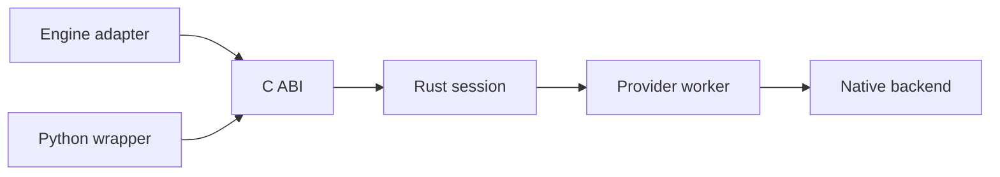

# Seabraid architecture

Engines own model loading, routing, scheduling, KV state, and the final merge.
An adapter prepares delegated work and passes the routed expert IDs and weights.
Seabraid owns the session, worker, buffers, and tickets. A provider executes the
batch on its backend.

The initial ABI accepts one preparation and one outstanding ticket per session.
Submit validates shape and copies the caller's data into Rust-owned storage.
The worker owns that storage until its callback returns. Collection publishes
the full output on success and returns the storage to the session for reuse.
A timeout preserves the ticket and its lease. Closing drains the worker before
releasing the provider context.

The C caller serializes session calls, supplies valid pointers for the duration
of each call, and keeps the provider context available until close returns.
The provider completes any device accesses to the supplied buffers before
returning, including on error. The reference provider computes a test transform
with routed weights. The C++ fixture supplies the same transform through a
provider callback. Python uses ctypes with an explicit library path. The
[capability and status API](INPUT-CAPABILITIES.md) reports supported routed
activation formats and provenance without inspecting media files.

A multi-operation provider declares a dense table of compatible operation
IDs. An adapter can map those IDs to model layers while sharing one worker,
batch shape, and buffer pool. The legacy ABI still submits operation zero.

The [Strata adapter](../adapters/strata/README.md) launches a dedicated
Qwen v7 helper with a sealed descriptor, verifies its identity and
geometry, and publishes the placement plan. One Rust session can select
any compatible layer on that channel. The engine routes only assigned
picks and uses zero-weight sentinels for work owned elsewhere. A lease
retires on uncertain completion. The controller drains and reaps before
a replacement starts with a fresh mapping. The helper uses a pidfd to
exit if the controller process dies without running teardown. The opt-in
Strata source patch delegates at its weighted merge and discards a serial
window whose helper failed. Future requests route locally once the tier is
retired.

The [ggml adapter](../adapters/ggml/MAP.md) executes routed SwiGLU using
backend-resident weights and one cached graph and device workspace. It
reuses the graph for new inputs with the same layer and shape. The pinned
llama.cpp patch can also append the operation to the engine's own Qwen3 MoE
graph and leave tensor placement, allocation, and continuation with its
scheduler. That path avoids extra host copies and per-layer graph
replacement. Native Q4_0 scheduler fixtures cover CPU execution. CUDA and
Vulkan evidence covers the direct callback. Model parity and mixed-device
scheduling remain open.

The [native placement API](PLACEMENT-ABI.md) exports executor tables for
the engine's hot path. Rust uses routing heat, cooldown, a move budget,
and epoch checks to propose swaps. At a drained boundary, the provider
copies both slots and acknowledges completion before publishing
ownership. The map restores known slots and quarantines uncertain rungs.
The Strata bridge translates synchronous rung callbacks and hands back an
executor table and epoch ready for publication. Active placement switches
when the engine drains every old publisher and uses this table for routing.
