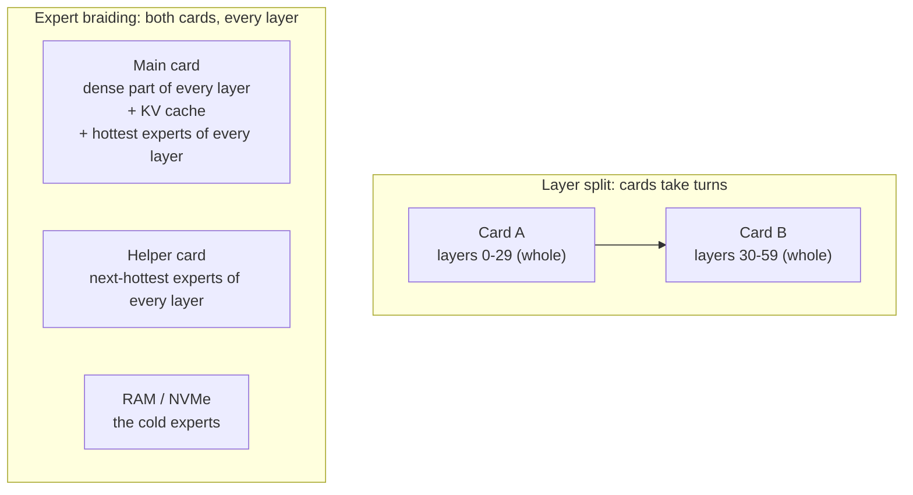
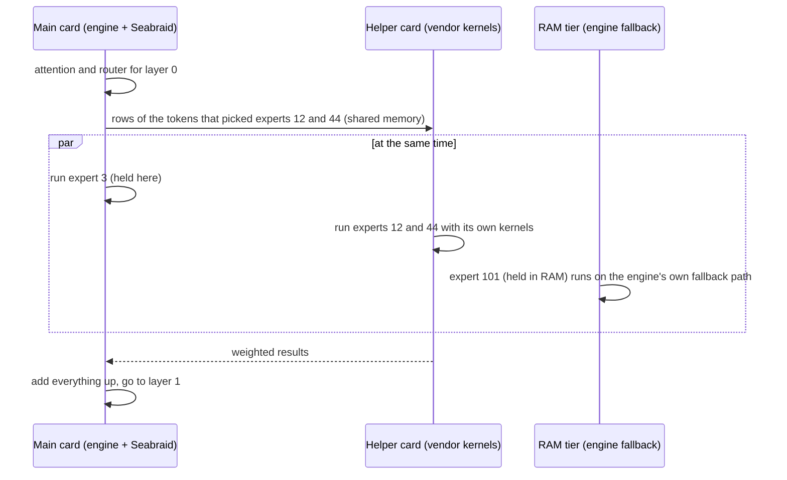
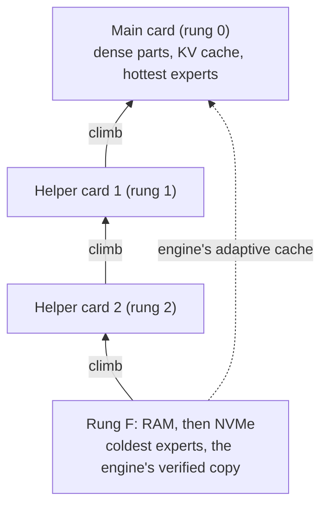
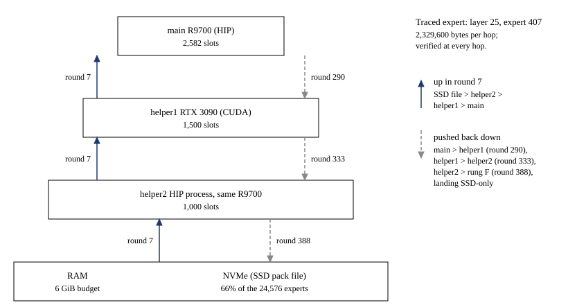

# How Seabraid works: expert braiding

Seabraid lets one mixture-of-experts (MoE) model use an NVIDIA card and an AMD card at the same
time, **inside every layer**. We call this **expert braiding** (in formal terms, *cross-vendor expert
parallelism*): each layer's experts are split across GPUs from different vendors, each running its
own vendor's runtime in its own process, so every card is a strand woven through every layer. This
page explains it without code. For the API, see the [engine integration guide](ENGINE-INTEGRATION.md);
for running it, the [user guide](USER-GUIDE.md).

Status: alpha. The new runtime has had live runs on one machine with an AMD R9700 and an NVIDIA
RTX 3090 (2026-11-16 and 2026-11-17: decode speed, helper-kill recovery, and a quality gate that
passed in both card orders); the first live-placement run did not pass on stall-inclusive decode speed
([figures](../README.md#whats-verified)). Live placement is therefore **experimental and opt-in**; static placement is the
supported default. The current code has not been re-measured on GPUs yet. Details and dates: [research log](RESEARCH-LOG.md).

## 1. What a mixture-of-experts layer is

A model is a stack of layers. In an MoE model each layer has two kinds of parts:

- **The dense part**: attention, the router, norms, and sometimes a shared expert. Every token uses it.
- **The experts**: many separate feed-forward blocks (for example 128). The router picks a few of them
  for each token (for example 8). The experts hold most of the model's weights, but each token touches
  only the few it was routed to.

Illustrative sizes for one layer (round numbers, not a specific model):

| Part of one layer | Size | Used by |
|---|---|---|
| Dense part | about 0.1 GB | every token |
| 128 experts, about 20 MB each | about 2.5 GB | each token uses 8 |

So the experts are the part that does not fit, and also the part that is used sparsely.

## 2. Two ways to use two cards

**Layer split** (what most multi-GPU setups do): card A holds layers 0 to 29, card B holds layers 30
to 59. A token runs through card A, then card B. The cards take turns, and each must hold whole layers.

**Expert braiding** (what Seabraid does): every layer is cut along its experts. Each card holds a slice of
**every** layer's experts, and both cards work on the same layer at the same time.

## 3. What is on each card

| | Main card (e.g. AMD, ROCm) | Helper card (e.g. NVIDIA, CUDA) | RAM / NVMe |
|---|---|---|---|
| Dense part of every layer | yes | | |
| KV cache | yes | | |
| Experts | a share of each layer's experts | another share of each layer's experts | the rest |
| Scheduler, sampling, model loading | the engine | | |
| Process | the engine and the Seabraid runtime | a small helper with the vendor's own kernels | |

No card holds a whole layer, and every layer has pieces on every card. A table, kept per layer, says
which card holds which expert. Which card is "main" is a choice; the ranking helper picks the best one.

## 4. One layer, step by step

A token at layer 0 was routed to experts 3, 12, 44 and 101.

1. The main card runs layer 0's attention and router.
2. Seabraid splits the picks by where each expert lives.
3. Picks for the helper are packed: only the rows of the tokens that need them ("compaction"), with the
   expert ids and weights. They go over shared memory.
4. Each card runs its share **at the same time**, each with its own vendor's kernels.
5. The results come back and are added on the main card. Then the same happens for layer 1.

**Why a separate helper process?** It is our design choice: giving each card its own vendor-native
process keeps the two toolkits apart, lets a stuck or dead helper be replaced or retired without
restarting the engine, and contains its failures. So the NVIDIA card runs a small helper process,
and the two meet in shared memory once per layer. There is no network involved.

### Reading a long prompt (prefill)

A prompt sends thousands of tokens through each layer at once, so nearly every expert is needed.

- **Lending (the default).** The helper lends its experts to the main card for the prompt: their
  weights are copied over and the main card computes the whole layer. Keeping the helper's experts in
  the engine's RAM copy cut a 32k-token prompt's first token from 32-36 s to 18-20 s (one machine,
  2026-11-17, [research log](RESEARCH-LOG.md)).
- **Helper compute (opt-in, patch 0013).** The helper computes its own experts during the prompt
  instead of lending them. On an 8.3k-token prompt that was slower than lending; the design log
  estimates it pays off only on much longer prompts.
- **Expert preflight: loading experts before the router asks.** Ours: at the start of a request,
  predict from its task, effort and length which experts it will use and stage them early. The capture
  and replay tools exist (`compat/strata/tools/capture_expert_preflight.py`,
  `expert_preflight_replay.py`), but it has only been evaluated in offline replay and is not in the
  engine yet ([roadmap](ROADMAP.md)). Separately, Strata itself already warms the next layer during
  decode and prefetches from its NVMe tier; preflight is measured against that.

## 5. More than two cards: the pyramid

Two cards are only the smallest case. The placement takes up to 63 cards (the planner's limit; the Strata patch and the installer take at most
three helpers), ranked into a ladder: the
main card is rung 0, the best helper rung 1, the next rung 2, and so on. Below the cards sit RAM and
then NVMe (SSD). Together they form a pyramid, hottest experts at the top:

The same ladder as it ran on real cards (live run L1; the numbers are in the
[research log](RESEARCH-LOG.md#2026-11-19--live-run-l1-the-pyramid-on-real-cards)):

*Figure 1. Live run L1 on one machine (the main card an R9700 on HIP, helper1 an RTX 3090 on CUDA, helper2 a second HIP process on the same R9700, not a third card, rung F the engine's RAM plus NVMe): expert 407 of layer 25 climbs from the SSD file to the main card in round 7 (solid arrows) and is pushed back down in rounds 290, 333 and 388 (dashed arrows).*

- **Filling the pyramid.** At start, experts are placed hottest first: the main card fills first,
  then each helper card in ladder order, and the rest stay in rung F (RAM, with NVMe behind it).
- **Climbing.** While the model runs, Seabraid counts how often each expert is picked and plans swaps
  between **neighbouring rungs**: a hot expert trades places with a cold one of the same layer on the
  rung above. Each step is an ordinary swap with its own acknowledgement and rollback. With
  `max_hops_per_round` above 1 one expert may climb several rungs in a single round, as a chain of
  swaps that each commit or fail on their own; a climb that stops early rests on the last rung it
  reached. The fields are in [PLACEMENT-ABI.md](PLACEMENT-ABI.md#policy-v2-the-fallback-boundary-and-climbs).
  The full rules (what counts as hot, who displaces whom, the margin, the cooldown and how a cooled expert
  goes down one rung at a time) are in the
  [demand-driven placement policy](PLACEMENT-ABI.md#demand-driven-placement-policy), each rule with a test.
- **The fallback boundary.** RAM and NVMe together are rung F. With `fallback_boundary` on, Seabraid
  also swaps between the last helper card and rung F: it loads an expert from the engine's verified
  copy onto the helper and drops a cold one back. The boundary between the main card and rung F stays
  with the engine (Strata's adaptive cache copies hot experts from RAM or NVMe into the main card and
  drops cold copies), so each boundary has one publisher. Placement planned on the pyramid is
  opt-in. It has run once on real cards ([live run L1, 2026-11-19](RESEARCH-LOG.md#2026-11-19--live-run-l1-the-pyramid-on-real-cards)): in the natural-traffic run every
  one of 1539 moves in 513 rounds committed with `verified=1` and no stale-epoch refusal, across all three
  boundaries (main to helper1 520, helper1 to helper2 481, helper2 to rung F 538). Decode speed against static
  placement was **not measured**: the run was starved on purpose, so its 4.2 to 7.8 tok/s is not a performance
  claim. See [what is verified](../README.md#whats-verified).
- **What RAM holds.** With Strata, RAM normally keeps a pinned copy of **every** expert, so "moving
  up" to a GPU is copying an expert into its cache and "moving down" is dropping that copy. An expert
  no GPU holds is computed by the CPU in place in RAM, at the same time as the GPUs work (or, for a
  share of them, copied over PCIe for that use). NVMe holds experts only when RAM cannot (Strata's
  low-RAM mode and file tier).
- **How many cards.** The runtime takes up to 63 cards. The Strata patch accepts up to three helper
  processes, one per entry in the `SEABRAID_STRATA_SHM` list (see the [options catalog](OPTIONS.md)); a run with
  more than one helper has one live record ([live run L1, 2026-11-19](RESEARCH-LOG.md#2026-11-19--live-run-l1-the-pyramid-on-real-cards)): one machine, main card an R9700 (HIP),
  helper1 an RTX 3090 (CUDA), helper2 a second HIP helper **process** on the same R9700. Every rung served and
  swapped. Three physical cards and a third helper process are **not yet shown on GPUs**. Losing a named helper
  failed in that run: a killed helper stalled decode for 30 s and the engine then exited. After the fixes (patches 0019
  and 0020: only the dead helper's card closes, the request finishes on the CPU, a restart with a dead helper opens its
  card closed) the [helper-loss runs HL and HL2, 2026-11-20](RESEARCH-LOG.md#2026-11-20--helper-loss-on-gpus-hl-hl2)
  passed on GPUs. A restart while a live helper is still in its shutdown state has only the CPU test. The private
  helper tier (`SEABRAID_QWEN_HELPER`) is one helper, and the legacy re-tier modes refuse more than one. In its
  natural-traffic run 538 promotions came from rung F (413 from RAM, 125 from the SSD pack file); by-reference moves
  and compaction were not exercised in L1. The second live run ([L2, 2026-11-20](RESEARCH-LOG.md#2026-11-20--live-run-l2-one-expert-through-every-level)) followed one expert through every level and ran file-reference moves; compaction with the pyramid was not run, because its flag acts only on the private helper tier, which has one helper.
- **Which cards.** Any card whose backend can run a provider can be a rung. Verified so far: CUDA and
  ROCm through the Strata path, and ggml's CPU, CUDA, HIP and Vulkan backends on a test fixture
  (Vulkan on both the AMD and the NVIDIA card). An Intel card through Vulkan (or Strata's SYCL backend)
  should work the same way but has not been tested.

## 6. Why this works when the model is bigger than all the cards

- **Routing is uneven.** A minority of hot experts receive most of the picks. The pyramid puts them
  on the GPUs and the cold ones in RAM or on NVMe, so most picks run on a GPU even when most expert
  bytes are not on one.
- **Heat is measured while the model runs**, so the pyramid follows the conversation.

## 7. Moving experts safely

A swap changes which weights a card holds while the model is serving. It is done in a fixed order:

1. **Stage**: copy the new expert's weights into a buffer the runtime owns.
2. **Replace**: the card writes them into the slot.
3. **Acknowledge**: the card confirms the write. Only then does the routing table change.
4. **Epoch**: the placement gets a new epoch number. A batch routed with the old table is refused, so a
   token is never sent to a card that no longer holds its expert.

If a write fails, the old weights are restored or that card is taken out of rotation and reported.
A wrong expert never runs silently.

### File-reference moves (opt-in)

By default a swap carries the new expert's bytes, which the engine has read first. An expert that lives only on
NVMe would be read into the engine's RAM just to be copied on, so with `--retier-file-moves 1` the engine can instead
send the helper a **reference** (which file, which byte ranges), and the helper reads the expert straight from the model
file. Seabraid never sees a file or a path: it asks the engine, which answers "by reference" or "use bytes".

- **Nothing is trusted on faith.** The reference carries no path, only numbers into files the helper opened at launch.
  The bytes the helper reads are checked against a checksum made at install time (`seabraid-sums`, written to
  `expert-sums.v1` beside the pack) before any card slot is written, so a wrong or changed file is refused and the move
  falls back to the byte path, which checks its own read the same way. The helper takes that checksum from its **own**
  copy of `expert-sums.v1`, looked up by the expert the swap names, and works out the byte ranges from its own copy of
  the pack layout; the reference must match both, so a reference can never put one expert's bytes into another
  expert's slot. A checksum that merely arrives with the reference is never trusted. If the engine's own read of an expert disagrees
  with the checksum, that move is refused: the expert keeps serving where it is, is never moved, and is logged as an
  error. If a helper's read disagrees, the move falls back to bytes (which the engine checks again) and file moves are
  switched off for that helper for the rest of the session with one warning; other helpers are unaffected.
- **Off unless asked.** The installer turns it on with `--file-moves` (it needs `--ladder`), builds or verifies the
  checksum file first, and refuses if it cannot (including when the `seabraid-sums` tool is not built). The helper reads with `--file-io auto` (direct I/O where the filesystem
  allows it, else a normal read). It has run on real cards in [live run L2, 2026-11-20](RESEARCH-LOG.md#2026-11-20--live-run-l2-one-expert-through-every-level): 744 moves in 248 rounds, 124 of them by file reference, with `bad_sum=0` over 372 helper reads and decode-path KL at the noise floor. L1 did not use file moves. By-reference writes were 2.6 to 3.0 times slower than byte writes (the helper reads the NVMe itself), while the main card's stage time was 12 to 15% lower; no decode-speed gain is claimed, so it stays opt-in; the
  [options catalog](OPTIONS.md#re-tiering-and-residency) has the rows.

### Seeing what moved (opt-in trace)

With `SEABRAID_TRACE=<path>` the placement driver writes a JSON-lines file: every expert move (both experts,
rungs, source, bytes, stage and write time, and whether it was read back), every round, each helper's up and
down events, and per-window latency from submit to collect. `compat/strata/tools/trace_report.py` turns it into
a table of each expert's journey and a latency table. A trace that cannot be written logs one warning and turns
itself off; it never changes serving. The switch row is in the [options catalog](OPTIONS.md#re-tiering-and-residency).
One real journey from [live run L1, 2026-11-19](RESEARCH-LOG.md#2026-11-19--live-run-l1-the-pyramid-on-real-cards): expert 407 of layer 25 (2329600 bytes, `verified=1` at every hop) climbed from the
SSD pack file to helper2, helper1 and the main card in a single round (round 7), then was pushed down again:
main to helper1 (round 290), helper1 to helper2 (round 333), and helper2 to rung F, landing SSD-only (round 388).
That run used lab-only extra log lines to see the displaced expert and RAM against SSD; the shipped trace now
records both, but no trace file from a live run exists yet, so no sample `trace_report` output is shown.

## 8. Who owns what

| Job | Seabraid (the runtime) | The engine (Strata today) |
|---|---|---|
| Scheduler, batching, KV cache, sampling, model loading | | yes |
| Attention and the router | | yes |
| Splitting each layer's picks by card, collecting and summing the results | yes | calls Seabraid once per MoE layer, keeps its own fallback at the merge |
| Helper processes on other vendors' cards, shared memory, liveness | the adapter (`adapters/strata`) | launches the adapter |
| Which card holds which expert (the ownership map), heat, the swap plan | yes | supplies routing counts |
| Copying expert bytes during a swap | asks, checks, commits or rolls back | does the copy (`stage` and `replace` callbacks) |
| Stopping and draining work before a swap, the epoch fence | sets the rule, refuses stale batches | stops admission at the fence |
| RAM and NVMe, and the main card's own expert cache | | yes |

### Where experts move, and who moves them

- **At start (fill), every tier.** Experts are loaded from the model file and RAM onto every card,
  hottest first: main card, then each helper, then the rest stay in RAM or on NVMe. Seabraid computes
  the plan (`seabraid_placement_fill`); the engine loads the bytes.
- **While running, RAM/NVMe to the main card: yes, by the engine.** Strata's adaptive cache copies hot
  experts from RAM (or NVMe) into the main card's cache and drops cold copies. Seabraid does not plan
  this boundary.
- **While running, card to card: yes, by Seabraid.** Same-layer swaps between neighbouring cards. With
  `max_hops_per_round` above 1 one expert can climb several cards in one round.
- **While running, rung F (RAM and NVMe) to a helper card: yes, by Seabraid, when `fallback_boundary`
  is on.** The swap is between the last helper card and rung F, so an expert reaches an upper helper
  by climbing from F, one hop per rung. The bytes come from the engine's verified copy (its RAM copy
  or the model file). With `--retier-file-moves` the helper may read the expert from the model file
  itself (see [section 7](#file-reference-moves-opt-in)), which ran in live run L2. In the add-on's own re-tiering
  (`--retier on` with `--retier-promote on`) the older behaviour is unchanged: heat-ranked LOADs from
  RAM onto the helper, EVICTs back, and promotions to the main card.

### Settings

Every tweak is opt-in and has one row in the [options catalog](OPTIONS.md): its owner (a Seabraid library
field, an engine flag or environment variable, or a patch), the exact switch, the default, which engines
support it today, and the measured evidence. Live re-tiering is off by default and stays experimental. The
placement policy fields are in [PLACEMENT-ABI.md](PLACEMENT-ABI.md#policy); the full switch lists for each
engine are in the [Strata adapter](../adapters/strata/README.md) and the [add-on](../compat/strata/README.md).

How an engine adds the per-layer call and the callbacks is in the
[engine integration guide](ENGINE-INTEGRATION.md).

### Not covered: dense shards

Braiding splits **routed experts**, whose outputs are selected and weighted per row. Splitting the
dense part of a layer (attention, or a dense feed-forward block that every token uses) the same way is
a deferred research idea, not something Seabraid does: it would need a shard axis, an intermediate
layout, and a reduction over every shard for every token. See [DECISIONS](DECISIONS.md).

## 9. Glossary

| Term | Meaning |
|---|---|
| Expert braiding | Splitting each MoE layer's experts across GPUs of different vendors, each running its own native runtime in its own process, all working on the same layer at once (formally: cross-vendor expert parallelism) |
| Expert | One feed-forward block in an MoE layer |
| Router | The small network that picks experts for each token |
| Top-k | How many experts each token uses per layer |
| Main card | The card that runs the engine, the dense parts and the KV cache |
| Helper | A separate process that runs one card's experts with that vendor's kernels |
| Heat | How often an expert is picked, measured during serving |
| Placement | Which card, RAM or NVMe holds which expert, per layer |
| Ladder / rung | The ranked order of cards: rung 0 is the main card, rung 1 the best helper, and so on; below the cards is rung F (RAM and NVMe). Live swaps move experts between neighbouring rungs, and one expert may climb several in a round |
| Epoch | A version number of the placement; stale batches are refused |
| Compaction | Sending a helper only the token rows that picked its experts |
