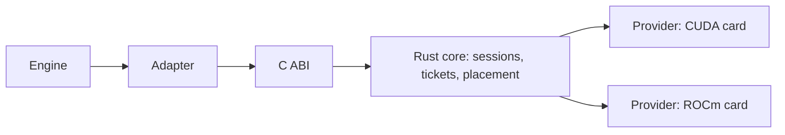
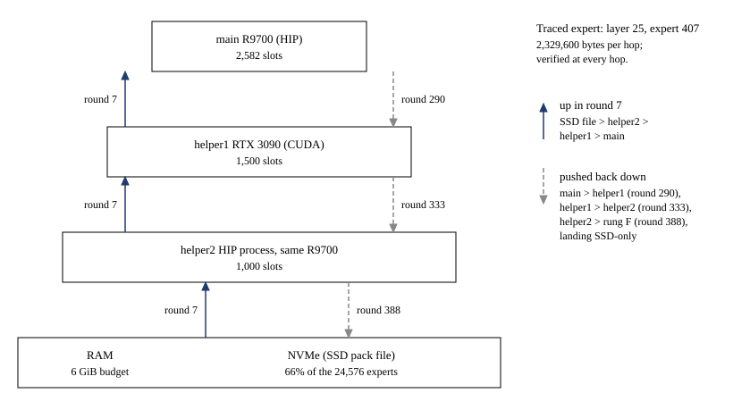
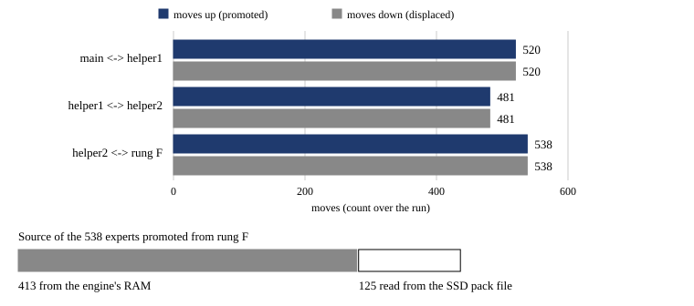
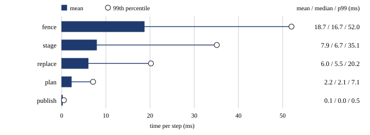
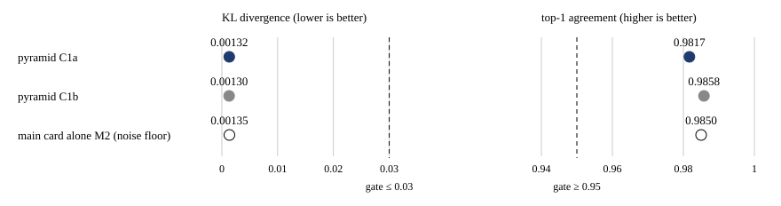
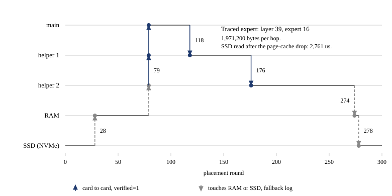

# Seabraid: an engine-neutral runtime for same-layer, mixed-vendor Mixture-of-Experts execution

**Saltwater Research LLC** · Technical note · written 2026-11-15, status updated 2026-11-19 · Software version 0.5.0-alpha.8

This note describes an alpha release. It distinguishes measured results,
repository test results, and work that has yet to run.

## Abstract

Mixture-of-Experts (MoE) models are often too large for one consumer GPU.
Running the same model on two cards from different vendors (NVIDIA and AMD)
requires both vendors' native kernels. Seabraid deliberately runs each vendor's
runtime in a separate process to isolate the toolkits, allow worker replacement,
and contain failures.

Seabraid implements *expert braiding* (cross-vendor expert parallelism). At
each layer, vendor-native processes serve experts from the same model. Each
card runs its own vendor's kernels in its own process. Once per layer, the
engine sends routed rows through shared memory, each card computes the experts
it holds, and the engine merges the partial sums. Seabraid exposes the
mechanism through an engine-neutral C ABI. Partial routes let several devices
split one layer, and live expert placement uses acknowledged swaps at an
engine-drained fence.

We measured an earlier Strata add-on that uses the same mechanism. The
add-on tied stock when the model fit on the main card (95.9 vs 96.0 tok/s).
At a smaller expert cap, it answered 8 of 10 classification prompts.
Stock answered 0 of 10. That comparison used a different metric and workload,
and one quality gate failed.

The new runtime ran live across vendors on one machine (AMD R9700 and NVIDIA
RTX 3090, each as engine and as helper). The runs covered serving speed and
recovery after killing the helper. A quality gate on Strata v0.2.15 passed in
both card orders. The first matched-arm run of live placement was small and
did not pass on stall-inclusive decode speed.

One live placement pyramid run used a main card and two helper processes,
with two thirds of the experts on NVMe. It committed 1,539 expert moves across
all three boundaries and verified every move. Decode-path KL against the main
card alone was 0.0013 (gate 0.03). That run did not survive the loss of a named
helper; after two fixes, a second pair of runs did (section 7). Live placement remains experimental and opt-in. Static placement is
the supported baseline.

On a loaded model, the opt-in llama.cpp hook is bit-identical to stock on four
backends. An expert split inside llama.cpp and Windows handle handoff have yet
to run.

## 1. Problem

A MoE layer routes each token to a few of its many experts. The experts hold
most of the model's weights, but each token touches only a handful per layer.
When the model exceeds one card's memory, engines tier experts across VRAM,
host RAM and NVMe. They keep the most frequently used experts in VRAM. A
second GPU can provide another, faster tier and raises several design issues.

1. **Process boundary.** Each vendor ships its native kernels in its own
   toolkit. Seabraid deliberately runs each vendor's runtime in a separate
   process. This isolates the toolkits, lets the engine replace a worker
   without restarting, and contains worker failures.
2. **Granularity.** A layer split assigns whole layers of weights to each card
   and leaves one card idle while the other works. Splitting the experts within
   each layer lets both cards work on every layer and puts the hottest experts
   in the fastest memory.
3. **Maintenance.** Expert usage shifts during serving, so placement changes.
   Moving an expert between cards while requests are in flight is error-prone.
   Without shared placement logic, each engine would have to implement it.

## 2. Design

The engine handles model loading, routing, scheduling, KV state and the
final merge. Seabraid manages sessions, workers, tickets, buffers, validation
and placement tracking. A **provider** executes a batch on one device using
native kernels. An **adapter** connects an engine to the ABI.

Seabraid copies each submitted batch into Rust-owned storage. The lifetime
rules and the host's responsibilities are documented in [ABI.md](ABI.md).
For example, after a close times out, the host must keep the provider context
and callback code valid for the process lifetime. The core opens no sockets
and uses no network.

## 3. Mechanism

The engine routes tokens to experts at each layer. For each device, the
engine builds a batch from the rows with expert selections that device owns.
It masks the other selections (`SEABRAID_SKIP_EXPERT_ID`,
weight zero). Each device returns the weighted sum of the experts it computed.
The engine adds those partial sums to the output of its local experts. At
each epoch, placement assigns exactly one executing owner to each
(layer, expert) cell. This keeps the sum complete and prevents double counting.

For cards from different vendors, the Strata adapter launches a helper
process per card, as described in §1. Each helper is built with its vendor's
toolkit and exchanges batches with the controller through shared memory. The
controller passes a sealed memory descriptor to the helper without a named
mapping. It validates the descriptor's identity and geometry and starts a
pidfd watcher. The watcher causes the helper to exit if the controller dies
without teardown. A helper that fails or times out is retired. Later
requests route locally. This path uses neither the network nor
peer-to-peer transfer.

## 4. ABI

The C ABI ([reference](ABI.md)) supports sessions with a single in-flight
ticket. Provider callbacks v1 expose one operation. Provider callbacks v2
expose a dense table of operations on one worker, with a partial-routes flag.

The ABI also provides capability discovery, activation provenance tags, status
counters, a log sink, a last-error query, a version string, and the placement
API. Calls copy their inputs. The ABI is alpha and may change before 1.0.

## 5. Placement

Placement binds one engine model layout to a Rust ownership map and a planner
that uses routing heat ([details](PLACEMENT-ABI.md)). The Rust map is a port
of the ownership map our patch 0012 adds to Strata.

- **Fill.** Place experts hottest-first. Fill the lead card, then fill each
  helper in order. Place the remaining experts on a verified fallback rung
  (host or disk).
- **Plan.** Given routing heat for a window, the planner proposes swaps within
  a layer. It promotes a hot expert from a slower rung and displaces the
  coldest resident expert. The planner uses a cooldown, a promotion margin,
  a per-round move budget and a per-layer helper-share ceiling. Planning
  performs no provider work.
- **Apply.** The engine stops admitting work and drains in-flight work.
  Seabraid then runs the stage and replace callbacks and commits ownership
  only after acknowledgement. A refusal changes nothing. A failure restores the known slot. If completion is uncertain,
  Seabraid quarantines the card and routes its cells to the fallback.
- **Publish.** Seabraid publishes the new executor table and its epoch at the
  same fence. This prevents batches from using a partially applied swap.

Rust tests and a native placement fixture exercise these rules. On 2026-11-18, the
first live promotion timing used a real model. This was one matched-arm run
with two to four starts per cell. It did not pass on stall-inclusive decode
speed, so the result remains preliminary. Live promotion is experimental and opt-in. Static
placement is the supported baseline. See the
[research log](RESEARCH-LOG.md#2026-11-18--first-matched-arm-run-of-the-live-placement-publisher-s8).

## 6. Measured results

These figures come from the earlier Strata integration for Strata. Seabraid
generalizes its helper mechanism, but the figures do not measure the Seabraid
runtime. See [the add-on README](../compat/strata/README.md). Every figure
represents one run (n=1) unless a count is given. The model is Qwen3.8-Flash-Next
(GSQ-RCO quants) unless stated otherwise.

| What | Hardware | Result |
|---|---|---|
| Strata alone, IQ2_XS | RTX 3090 + RTX 3060 / R9700 alone | 113.4 tok/s e2e / 98.6 tok/s; expert cache 99.8% hit, so a second card adds nothing for this model |
| Strata integration, model fits on the main card (expert cap 11,000) | R9700 32 GB main + RTX 3060 helper | 95.9 vs 96.0 tok/s e2e (stock): a tie |
| Strata integration, model does not fit (expert cap 4,000) | same | 8 of 10 classification prompts answered at ~70 tok/s decode; stock 0 of 10 (hung), stock greedy 52-60 tok/s |
| IQ3_S, all in VRAM | R9700 32 GB main + RTX 3090 24 GB helper (PCIe 3.0 x8, 280 W cap) | 105.5 / 106.0 / 105.6 tok/s (tiered config) and 105.9 / 105.9 / 105.6 tok/s (all-VRAM config), 3 x 2,000-token greedy, by wall time |
| IQ3_S, tiered, for comparison | R9700 + RTX 3060 | 96-99 tok/s (run 2: 99-101) |
| Per-card expert throughput (IQ3_S layer 24, 200 decode iterations) | R9700 / RTX 3090, both capped at 250 W | 268,572 / 230,744 decode rows/s |
| DeepSeek-V4.1-Flash, 128 tokens, one 32-token prompt (historical: measured 2026-11-07 on Strata 0.1.58, add-on build `c9823b0`, tree `21f4e766`; Strata 0.2.14 removed its DeepSeek-V4.1 engine, so the add-on no longer builds it) | R9700 main + RTX 3090 helper | 10.08 tok/s with Strata integration vs 6.17 tok/s stock in the same session |
| Teacher-forced KL, 441 positions, mean top-32 | R9700 + RTX 3060 | stock vs stock 0.0025; Strata integration vs stock 0.0098 (top-1 agreement 96.1%) |

Caveats that matter:

- The two 3090 configurations agree because the RAM budget in the tiered
  configuration placed 0 bytes. Swapping cards accounted for the gain over
  the 3060 setup. Tiering did not contribute. We retracted an earlier
  prediction of +3-9%.
- An independent review attributed the DeepSeek speed-up (historical,
  2026-11-07, Strata 0.1.58) to reduced I/O. The 3090 acts as a 22.8 GiB cache
  in front of slower storage. More host RAM would likely have the same effect.
- The DeepSeek KL gate (historical, 2026-11-07, Strata 0.1.58) **failed** its
  thresholds, and noise dominated the results. Perplexity exceeded stock by
  +3.0% and +3.6% on the two segments. The independent review found the gap
  real based on paired statistics. The issue remains open and unexplained.
  Do not rely on the DeepSeek path for output quality.
- The hot-share option is opt-in and off. The helper's time per request
  roughly doubled. The per-window gain falls within run-to-run drift.
  The option showed no measured improvement.
- We have not verified any multi-request result on the 3090 setup, the
  Qwen 10-task bench on the 3090 setup, or the HIP build of the Strata
  v0.2.12 rebase.

## 7. Verification status

The table records verification status as of 2026-11-19. The
[research log](RESEARCH-LOG.md) dates each row and holds the test counts for
each date. To keep those figures current, the counts appear in the log alone.
All runs used one machine (AMD R9700 and NVIDIA RTX 3090 unless stated
otherwise). The last column identifies what each outcome counts, since
"one run" refers to different units across rows.

| Implementation | Executed | Outcome | Sample unit |
|---|---|---|---|
| Rust core, native CTest incl. the Strata static, private, helper-process, runtime and placement fixtures | Linux, 2026-11-16 to 2026-11-18, Release and ASan/UBSan; installed-SDK consumer 2026-11-16 | Passed at each recorded commit (fewer tests without the Strata adapter) | test cases |
| ggml adapter, Q4_0 routed SwiGLU | CPU, CUDA, HIP, Vulkan against ggml 1.0.0, 2026-11-17 | Matched the scalar oracle | fixture cases, one quant type |
| New runtime inside Strata, static placement, speed | Both card orders, Strata v0.2.15, 2026-11-17 (earlier pin, 2026-11-16: 89.5 to 95.0 tok/s) | 94.8 and 106.7 tok/s mean decode | 6 requests of 2,000 tokens per arm, one engine start per arm |
| Same, helper killed mid-request | 2026-11-17 | Request fails in 0.33 to 0.46 s and 0.51 to 0.73 s, next request served, no zombies | 3 kills per arm, each its own start |
| Same, quality gate (KL against the main card alone) | 2026-11-17 | Passed pooled in both card orders; one 650-position text scored 94.92% top-1 in the reversed order, and a stock-to-stock comparison across vendors also failed that text (independent audit) | positions: 3 texts (441, 650, 795), one start per arm |
| Same, long prompts and D4 remote prefill | 2026-11-17 | Needle found through 261k tokens; D4 read an 8.3k prompt slower than lending | prompt lengths; 2 requests for D4 |
| Live placement, Seabraid publisher against static and legacy, matched arms | 2026-11-18 | Did not pass stall-inclusive decode (private static 93.66, private live 75.66 tok/s, archived request means recomputed by the audit); pooled quality passed in both live starts, one text failed in both | 2 to 4 engine starts per cell; requests (194 promotion, 140 static or control) |
| Live pyramid L1: main R9700 (HIP), helper 1 RTX 3090 (CUDA), helper 2 a second HIP process on the same R9700, rung F = engine RAM + NVMe, capped capacity | 2026-11-19, Strata v0.2.15 patch series at repository commit e9cc304 | Passed: 1,539 moves in 513 rounds, all committed and verified, across all three boundaries; decode-path KL 0.00132 and 0.00130 against the main card alone (gate 0.03). **Failed:** two helper losses (a killed named helper stalled decode for 30 s, then the engine exited; see the HL row below). Not exercised in L1: file-reference moves (see L2), compaction, a third card | 513 rounds (1,539 moves); 2,400 positions per KL run; 2 helper losses |
| Live pyramid L2: same layout as L1; one expert through every level, and file-reference moves | 2026-11-20, built from commit f423da7 with Strata patches 0001 to 0018 and the v7 patch | Passed: one cell (layer 39, expert 16) made all eight transitions in 428 rounds, 7 of 14 steered cells did; 1,281 committed moves, 3 non-committed, 0 stale epochs. File-reference moves: 744 moves in 248 rounds, 0 non-committed, 124 hops by file reference, `bad_sum=0`. Decode-path KL with file moves live 0.00116 and 0.00121 against a noise floor of 0.00116 (gate 0.03). Not run: compaction with the pyramid | 14 steered cells; 2,400 positions per KL run; 744 moves |
| Helper loss, named-channel helpers: HL and HL2, the L1 layout | 2026-11-20; HL at commit f04173e (patches 0001 to 0019 and v7), HL2 with patch 0020 | Passed: a helper killed mid-request, 7 of 7 requests OK in each run, one engine start, the dead helper's card closed 22 to 93 ms after the kill; a helper killed while idle, 4 of 4 later requests OK, the card closing 34 to 203 ms into the next layer request; restart with both helpers dead after an engine SIGKILL, ready in 34 to 35 s. **Failed in HL:** restart after a graceful engine stop (state 5, engine exit); fixed by patch 0020 and passed in HL2 (ready in 32 s, 6 of 6 requests OK). Not shown on GPUs: restart while a live helper is still in its shutdown state (CPU test only). Machine load 4 to 14, so no timing is a performance figure | 2 runs of S7 plus 1 in HL2; 4 requests (S8); 2 restarts per run |
| llama.cpp opt-in hook, loaded Qwen3-30B-A3B | CPU 2026-11-17; CUDA, HIP and a Vulkan layer split 2026-11-18 | Logits bit-identical to stock; the hook does not call the Seabraid runtime, so this is not an expert split | 2,044 positions over 4 texts per backend |
| Strata integration (older mechanism) | 2026-11-07 to 2026-11-09 | Figures of section 6 | runs and prompts as given there |

An expert split inside llama.cpp and Windows handle handoff have yet to run.
Adapters for vLLM, SGLang, KTransformers and Project Maya have yet to be
written.

### Live pyramid (L1)

The run used one machine. The main card was an R9700 (HIP), helper 1 was an
RTX 3090 (CUDA), and helper 2 was a second HIP process on the same R9700.
There was no third card. Rung F combined the engine's RAM and NVMe. Capacity
was capped, so 66% of the 24,576 experts resided on NVMe. The figures use the
numbers in [`img/data`](img/data) and were generated by
[`img/gen_l1_figures.py`](img/gen_l1_figures.py). The full record appears in
the [research log](RESEARCH-LOG.md#2026-11-19--live-run-l1-the-pyramid-on-real-cards).

*Figure 1. Live run L1 on one machine (the main card an R9700 on HIP, helper1 an RTX 3090 on CUDA, helper2 a second HIP process on the same R9700, not a third card, rung F the engine's RAM plus NVMe): expert 407 of layer 25 climbs from the SSD file to the main card in round 7 (solid arrows) and is pushed back down in rounds 290, 333 and 388 (dashed arrows).*

Under natural traffic, every move committed with `verified=1`. The engine's
RAM supplied 413 of the 538 promotions from rung F. The SSD pack file supplied
125.

*Figure 2. Committed placement moves per boundary and direction in the natural-traffic run (1,539 moves in 513 rounds, all verified), and where the 538 promotions from rung F came from.*

The placement round fence averaged 18.7 ms (99th percentile 52 ms), or about
1.2% of the time between rounds. The figure comes from one run and does not
represent a measured budget.

*Figure 3. Time per placement-round step over 513 rounds: bar is the mean, circle the 99th percentile; the fence averaged 18.7 ms, about 1.2% of the time between rounds. One run; steps are timed separately and are not claimed to add up.*

Decode-path KL against the main card alone passed the gate in both pyramid
starts (0.00132 and 0.00130, top-1 0.9817 and 0.9858). A second run with the
main card alone scored 0.00135 and 0.985.

*Figure 4. Decode-path KL (left, lower is better) and top-1 agreement (right, higher is better) of two pyramid starts against the main card alone, with a second main-card-alone run scored against the first as the noise floor; 2,400 positions over 6 texts, dashed line is the gate, the top-1 axis starts at 0.94.*

*Figure 5. Live run L2, same machine as L1: one expert (layer 39, expert 16, 1,971,200 bytes) goes SSD to RAM in round 28, to helper 2, helper 1 and main in round 79, back to helper 1 (118), helper 2 (176), RAM (274) and the SSD (278). Solid arrows are card-to-card hops (`verified=1`); dashed arrows touch RAM or the SSD and `verified=0` by design (the fallback copy has no read-back). The SSD read after the page-cache drop took 2,761 us; that the bytes came off the drive is inferred, not traced at block level.*

The run measured 4.2 to 7.8 tok/s decode under deliberate SSD starvation and
load from other work. We make **no** performance claim from that result. The
system failed the loss of a named channel helper in L1; the fixes are shown on
GPUs in the HL and HL2 rows of the table above.

## 8. Related work

We searched prior work on 2026-11-15 and extended the search on 2026-11-19
after an independent audit. We did not find a system that combines a
same-layer expert split across vendors, vendor-native workers, an
engine-neutral C ABI and acknowledged ownership changes at a drained
boundary. A search cannot establish priority. We make no "first" or "only"
claim and may have missed work. We welcome corrections. Strata's
`--peer-device` (below) is the closest same-layer split we found. It supports
CUDA only.

**Mixed-vendor execution.**
- *llama.cpp Vulkan backend.* A single process can use cards from different
  vendors. It assigns whole layers and uses Vulkan kernels instead of native
  CUDA or ROCm kernels.
- *HeteroLLM* (repository `coffeescript53/HeteroLLM`). A single-author benchmark
  uses llama.cpp to split a dense 70B model by layer across an RTX 5090 and an
  AMD R9700.
- *llama.cpp RPC backend.* Sends parts of a model to remote workers over the
  network using a layer or graph split. Its versioned handshake informed our
  protocol notes ([PROTOCOL](../compat/strata/docs/PROTOCOL.md)).
- *TritonMoE* (arXiv 2605.23911). Implements cross-vendor fused MoE dispatch
  in Triton (A100 and MI300X) on a single GPU. The paper identifies multi-GPU
  expert parallelism as future work.
- *MLC-LLM.* Supports multiple GPUs from NVIDIA or AMD, with one vendor per
  run.

**Expert placement and offload, single vendor.**
- *Strata `--peer-device`* (Strata v0.2.15, `docs/SECOND_GPU.md`). Places a
  second adaptive expert cache on another CUDA device. That device computes
  rows for its experts during decode windows and prompt chunks. Activations
  travel over NVLink or another peer-to-peer path. The same-layer expert
  split runs in one process and supports CUDA only. Seabraid supports the
  same-layer split across vendors (CUDA and ROCm) in separate processes
  through an engine-neutral C ABI. Strata's helper caches
  (`--expert-cache-device1` to `3`) and its layer split are also single-vendor.
- *Strata and Project Maya.* Tier experts across VRAM, RAM and NVMe on cards
  from one vendor. Seabraid bases its placement on Strata's tiered cache and
  ports the ownership map that the Strata integration adds to Strata (patch
  0012). The add-on extends the tiers with a second card from another vendor.
- *llama.cpp* provides an MoE expert cache and a ggml backend scheduler. Both
  work within the engine's own backends.
- *KTransformers and SGLang.* Use CPU/GPU hybrid expert placement. Some
  experts run on the CPU and the rest run on the GPU.
- *Fiddler* and *MoE-Lightning* coordinate CPU and GPU work for MoE inference
  on memory-limited GPUs. *OD-MoE* loads experts on demand. These systems
  move work or weights between a CPU and a GPU. They do not move them
  between GPUs from different vendors.
- *AdaOffload* (arXiv 2611.10219, Nov 2026). Runs hybrid expert execution
  across multiple GPUs with CPU offload on heterogeneous NVIDIA platforms
  (L4, Pro6000, B200), all from one vendor.
- *ThunderEP* (arXiv 2609.40093). Supports expert-parallel communication on
  PCIe consumer GPUs from NVIDIA only (RTX 4090 and 5090).
- *UCCL-EP* (arXiv 2512.19849). Uses CPU proxies for GPU transfers so the same
  expert-parallel (EP) code works with NVIDIA or AMD GPUs and several NIC
  vendors. Its evaluations cover each platform individually and do not say
  whether one job mixes GPU vendors. It provides a DeepEP-compatible API
  and does not provide an engine ABI.
- *MegaScale-Infer* (arXiv 2504.02263). Runs attention and experts in separate
  GPU pools at datacenter scale, with ping-pong micro-batches between the
  pools.

**Adaptive parallelism and placement, and CPU-GPU co-execution.**
- *Tutel* (arXiv 2206.03382). Uses a shared parameter layout for adaptive
  parallelism and pipelining in MoE. Strategies can change at runtime
  without moving tensors (sections 3 and 5). The evaluation at scale uses
  NVIDIA A100/CUDA. The first arXiv version also reports AMD MI100/ROCm
  kernel results in a separate panel (Figure 24). That panel does not show
  a mixed-vendor expert group. We did not find the panel in the text of the
  second version.
- *FlexMoE* (arXiv 2304.03946). Uses dynamic device placement for training.
  Its expand, shrink and migrate primitives move expert and optimizer
  state. The evaluation ran on NVIDIA A100 clusters. It provides a
  precedent for load-driven placement. It does not establish one for
  serving or for mixed vendors.
- *DeepSeek EPLB* (`github.com/deepseek-ai/EPLB`). Computes a load-based plan
  to replicate and assign experts and returns logical-to-physical maps.
  It provides a plan only. The consumer handles weight transfer, acknowledgement and failure
  recovery. Seabraid provides those operations in its apply step.
- *CoX-MoE* (arXiv 2605.17889). Runs experts on an AMX CPU and an NVIDIA GPU
  for throughput-oriented inference and assigns frequently used experts to
  the GPU statically. It provides a compute-on-RAM baseline and uses
  NVIDIA GPUs only.

**Heterogeneous training.**
- *HAP* (arXiv 2401.05965) distributes training work across A100 and P100
  GPUs from the same vendor. *HeterMoE* (arXiv 2504.03871) trains MoE models
  on clusters with newer and older GPUs. It separates attention from
  experts so older GPUs run only experts ("zebra parallelism"). It is the
  closest idea we found. It addresses training and does not address serving.
  Its abstract does not state that it mixes vendors, and it does not use
  separate vendor-native processes.

The 2026-11-19 update added details on UCCL-EP, MegaScale-Infer and HeterMoE.
We found no prior use of the term "expert braiding".

Seabraid's claim covers the combination of routed experts split within one
layer across vendors, vendor-native workers, an engine-neutral C ABI, and
acknowledged ownership changes at a drained boundary. The search did not
establish priority. The design generalizes Strata's architecture and draws
on llama.cpp's scheduler and CPU-GPU hybrid engines.

## 9. Limitations

- This is an alpha release. The ABI can change before 1.0.
- **Payoff conditions are measured at two points, not as a threshold.** When
  the model fit on the main card (expert cap 11,000), the add-on tied stock
  at 95.9 against 96.0 tok/s end to end. At an expert cap of 4,000, the
  add-on answered 8 of 10 classification prompts and stock answered 0 of 10.
  That comparison used a different metric and workload. Stock's greedy
  speed of 52 to 60 tok/s is a separate measurement. No paired, repeated
  sweep exists, so the payoff point for a second card remains unestablished.
  The results do not show that a second card helps only above a particular size.
- The evidence comes from one machine. Each row of the section 7 table has
  its own sample unit (requests, starts, positions). The older add-on
  figures come from single runs, and the DeepSeek quality gate failed.
- **The pyramid has two live runs (L1, L2).** A helper process stood in for
  a third card. Placement and quality passed, but L1 did not survive the
  loss of a named helper (re-run after the fixes: see the next item). L1 did
  not exercise file-reference moves. L2 did, and followed one expert
  through all eight transitions. In L2, `verified=1` covers the card-to-card
  hops; the two hops that touch the fallback log `verified=0` by design,
  because the fallback copy has no read-back. That the bytes came off the
  drive is inferred from a page-cache drop and a 2.76 ms read, not from a
  block-level trace. The RAM install and eviction were driven by a real
  switch of request type, because the RAM copy follows real routing, not
  the heat bias. Compaction has not run with the pyramid: its flag acts only
  on the private helper tier, which has one helper. By-reference writes were
  2.6 to 3.0 times slower than byte writes, and L2 decode (1.9 to 4.8 tok/s
  at box load 8 to 23) is load-contaminated, not a performance figure.
- **Helper loss.** A restart while a live helper is still in its shutdown
  state is covered by a CPU test only (the engine waits for that helper for at
  most 30 s); it was not run on GPUs. A helper killed while idle is noticed at
  the next layer request, not at the kill.
- **Live promotion is experimental and opt-in.** Static placement is the
  supported baseline. In the archived comparison, static placement
  decoded faster than live promotion (93.66 against 75.66 tok/s). The cause
  of the long pauses (moves or host memory pressure) remains unclear.
- The private descriptor handoff supports Linux only. It has yet to run on
  Windows.
- Two copies of activations cross the private handoff. No fast path has
  been measured.
- Card support on the Strata path depends on Strata's kernels (NVIDIA sm_80
  and newer, AMD RDNA3 and RDNA4).
- The llama.cpp hook showed parity on a loaded model and does not call the
  runtime. No expert split has run inside llama.cpp. Adapters for vLLM,
  SGLang and KTransformers have yet to be written. The Python binding has
  no split-phase submit or device-tensor boundary yet. See
  [engine integration](ENGINE-INTEGRATION.md#73-engines-with-no-adapter-vllm-sglang-ktransformers-ik_llamacpp).

## 10. Availability

See the repository root for the source, licensed under Apache-2.0
(public headers Apache-2.0 OR MIT, patches MIT). Saltwater Research LLC
created the software. Use [CITATION.cff](../CITATION.cff) when citing it.
Submit security reports through the private path described in
[SECURITY.md](../SECURITY.md). The release includes a Strata plug-in with the
Strata adapter and patch and the original Strata integration. Strata users can
use it to try expert braiding.

## 11. Acknowledgements

Strata (https://github.com/Niko1221/Strata) inspired this work. We thank Niko
(Niko1221) and the other Strata contributors. Strata's adaptive tiered expert
cache provided the starting point for Seabraid's placement, and expert braiding
first ran as an add-on to Strata.

We thank the llama.cpp and ggml contributors. The ggml backend scheduler and
the RPC backend's versioned handshake informed the design, and the ggml
adapter builds on ggml. We thank the KTransformers and SGLang developers for
their work on CPU/GPU hybrid expert placement, which informed the placement
design. We also thank the developers of the open tools we used to verify
this work, including Rust and Miri, the GCC and LLVM sanitizers, lizard,
CMake and pytest.

The measurements use models from the Qwen team (Qwen3.8-Flash-Next,
Qwen3-30B-A3B) and DeepSeek (DeepSeek-V4.1-Flash), and quantizations from
ISTA-DASLab (GSQ-RCO). We thank them for making these resources openly
available.

**Funding.** Saltwater Research LLC funded all of this work. The project
received no grants, sponsorship, donated hardware or other external support.

**Competing interests.** Saltwater Research LLC develops Seabraid. There are
no other competing interests.

**AI assistance.** An AI coding assistant helped draft parts of the code,
tests and text under the direction of Saltwater Research LLC. Saltwater
Research LLC reviewed and verified those materials and is responsible for
the content.
